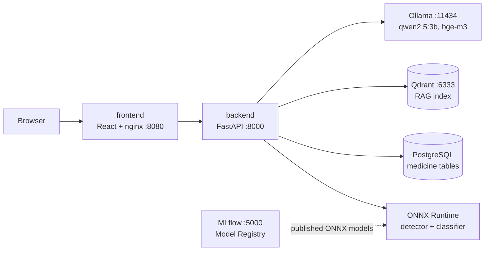
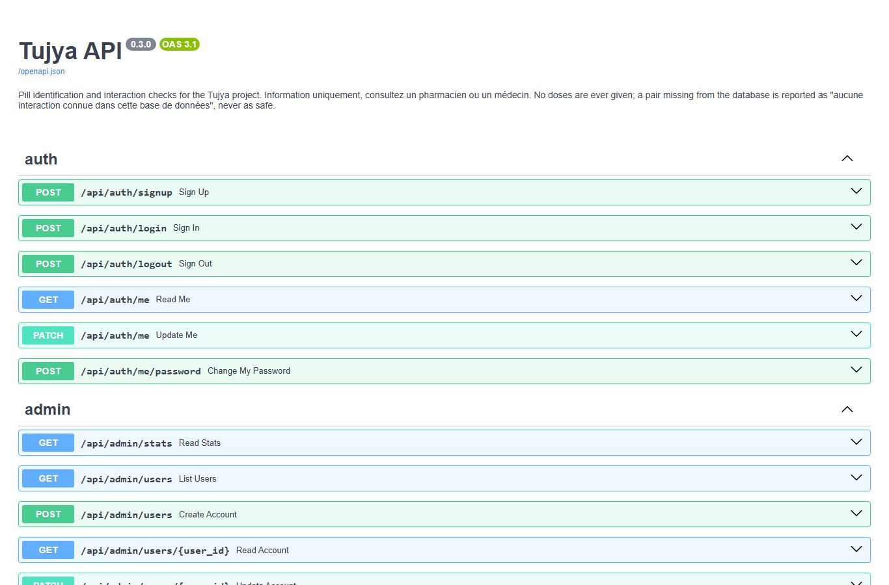

# Tujya

[](https://github.com/melekbouabid/syRX/actions/workflows/ci-tests.yml)
[](https://github.com/melekbouabid/syRX/actions/workflows/docker-build.yml)

Tujya is a decision-support platform for drug and dietary-supplement manufacturers. It checks
interactions between active ingredients (DDInter), predicts molecule toxicity (Tox21), answers
questions over official drug labels and the scientific literature with a cited RAG assistant,
and uses computer vision to flag look-alike risks with existing pills and to read packaging text
(OCR). The full MLOps lifecycle is automated (DVC, MLflow, ONNX, Docker Compose, GitHub Actions
CI/CD). Student project evaluated in two modules: **Vision & MLOps** and **AI Engineering**.

**Who it is for.** R&D and quality teams of drug and supplement manufacturing sites: Tujya gives
them quick, cited access to drug labels, the scientific literature and interaction data, to make
their daily checks easier.

**Problem solved.** Before producing a new medicine or supplement, a lab must check its
ingredients' interactions, their toxicity and whether its pill could be confused with an existing
product. This information is scattered across interaction databases, official labels, the
literature and pill image catalogues; Tujya gathers it in one tool with cited sources to speed up
and secure the first checks.

| Function | Where |
|---|---|
| Interactions between active ingredients (DDInter) | `POST /api/interactions` ([medicines.py](backend/app/routers/medicines.py)); Scanner page, interactions report |
| Molecule toxicity (Tox21 assays) | `POST /api/toxicity` ([toxicity.py](backend/app/routers/toxicity.py), model in [src/models/toxicity/](src/models/toxicity/)); Toxicity page |
| Cited RAG assistant (openFDA labels, PubMed, DDInter) | `POST /api/chat` ([chat.py](backend/app/routers/chat.py), agent in [src/agent/](src/agent/), RAG in [src/rag/](src/rag/)); chat panel of the Scanner page |
| Drug labels and literature with their citations | `GET /api/documents` ([documents.py](backend/app/routers/documents.py)); Documents page |
| Look-alike risk: a pill photo matched against 380 existing US pills (YOLO11s detection, EfficientNetV2-S top-5 with confidence) | `POST /api/scan`, `POST /predict`, `POST /predict/visualize` ([scan.py](backend/app/routers/scan.py), [vision.py](backend/app/routers/vision.py)); Scanner page (upload or webcam) |
| Packaging text (OCR) and the box's ingredients | `POST /api/scan` on a medicine box ([boxes.py](backend/app/boxes.py), OCR in [src/models/ocr/](src/models/ocr/)); Scanner page |

**Scope and limits.** Decision support and first checks only, not a regulatory validation. The
data cover marketed products (US pills from NLM C3PI, DDInter). The assistant never gives doses
(and never says a combination is safe); a pill match is a suggestion, always shown with its
confidence.

## Architecture



Services, ports and the flow of a photo and of a question: [docs/architecture.md](docs/architecture.md).

## Installation (one command)

Prerequisites: Docker Desktop (an NVIDIA GPU helps Ollama), the DVC data and the published models.

```bash
git clone https://github.com/melekbouabid/syRX.git && cd syRX
cp .env.example .env                               # contact e-mail for the data pipeline, project name
dvc pull                                           # data from the DVC remote
python -m src.models.registry publish              # served ONNX models from the Model Registry -> models/
docker compose up --build                          # the whole application
```

On the first start `rag-init` pulls the Ollama models and indexes the corpus in Qdrant (a few
minutes); scan and interactions work right away. Without a GPU:
`docker compose -f docker-compose.yml -f infra/ollama/cpu.yml up -d`. `docker compose down`
keeps the volumes.

| Address | What |
|---|---|
| http://localhost:8080 | web app (Scanner, chat, Documents, Monitoring, Toxicity) |
| http://localhost:8000/docs | Swagger UI of the API ([docs/api.md](docs/api.md)) |
| http://localhost:5000 | MLflow: experiments, Model Registry, Prompt Registry |
| http://localhost:6333/dashboard | Qdrant dashboard: indexed chunks and their metadata |
| http://localhost:8090 | Spark master UI (`docker compose --profile spark up -d`) |

Demo accounts created on the first start: `user@gmail.com` / `user` and `admin@gmail.com` /
`admin` (change the latter before any other use, `backend/.env.example`).

| Cited answer of the agent | Swagger |
|---|---|
|  |  |

## Documentation

| | |
|---|---|
| [Module 1: vision and MLOps](docs/module1/README.md) | data -> Kaggle + Optuna -> MLflow -> comparison -> champion -> ONNX -> API -> drift -> OCR; [results](docs/module1/results.md) |
| [Module 2: AI engineering](docs/module2/README.md) | corpus -> chunking -> Qdrant -> retrieval -> rewriting -> reranking -> RAG chain -> agent and MCP -> evaluation; [results](docs/module2/results.md) |
| [Data](docs/data.md) | sources, licences, counts before / after, cleaning, split without leakage, PySpark |
| [Key decisions](docs/decisions.md) | the main choices and the evidence behind them |

## Tests and checks

```bash
uv venv .venv -p 3.12 && uv pip install -p .venv -r requirements-dev.txt   # project venv
python -m pytest                                # tests of src/ (tests/)
cd backend && python -m pytest && cd ..         # API tests (backend/tests/)
python -m pytest tools/tests                    # Git hooks
cd frontend && npm ci && npm ci --prefix eslint && npm test && npm run lint && npm run build && cd ..
ruff check . && ruff format --check . && mypy
dvc status                                      # data and pipeline up to date
```

The CI ([.github/workflows/](.github/workflows/)) runs the same checks and builds the Docker
images without publishing them.

## Repository layout

```text
backend/            FastAPI app (app/) and its tests (tests/)
frontend/           React app (Vite, Tailwind), Vitest tests, screenshot scripts
src/
  data/             C3PI download, auto-labels, datasets, Spark jobs, polite data pipeline
  models/           training, Kaggle runners, comparison, ONNX export, quantization, Registry
  rag/              corpus, chunking, Qdrant index, retrieval, reranking, query rewriting
  agent/            LangGraph agent, tools, safety rules, MCP server
  evaluation/       retrieval and generation benchmarks, their result files
  utils/            MLflow helpers, Grad-CAM
tests/              tests of src/
config/             class tables, splits, search spaces, RAG grid, brand table
data/               DVC-tracked data (raw/, processed/, external/), never in git
notebooks/          summary notebooks of both modules, Kaggle training notebooks
infra/              MLflow, PostgreSQL, Ollama and Spark images and settings
tools/              Git hooks and their tests
docs/               documentation (this README links every page)
docker-compose.yml  the whole stack; dvc.yaml + params.yaml: the DVC pipeline
```

## Contributing

- Branches: `main` is always stable; work happens on `feature/<topic>`, `fix/<topic>`,
  `refactor/<topic>`, `docs/<topic>`, `chore/<topic>` and one `experiment/<model>` branch per
  training experiment, merged with `git merge --no-ff`.
- Commit messages follow [Conventional Commits](https://www.conventionalcommits.org/):
  `type(scope): description`, with type `feat`, `fix`, `exp`, `data`, `docs`, `refactor`,
  `chore`, `test`, `ci`, `perf` or `style`.
- Hooks ([.pre-commit-config.yaml](.pre-commit-config.yaml), install with
  `pre-commit install --hook-type pre-commit --hook-type commit-msg`): ruff, ESLint, notebooks
  without outputs, no hard-coded secret, commit message format.
- Annotated tags mark validated milestones; models are versioned in the MLflow Model Registry
  (aliases `champion`, `challenger`, `served`), data with DVC.
