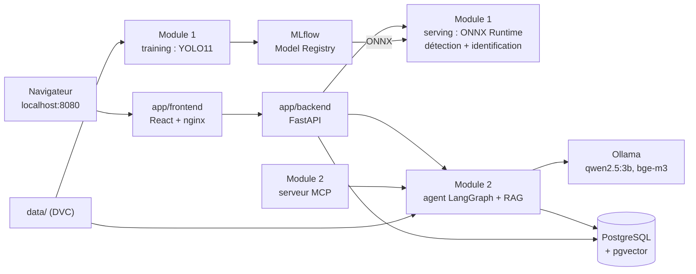

# Tujya

[](https://github.com/melekbouabid/tujia-/actions/workflows/ci.yml)
[](https://github.com/melekbouabid/tujia-/actions/workflows/cd.yml)

**Tujya** est une application de sécurité du médicament. On photographie un ou plusieurs
comprimés (upload ou webcam) : un modèle YOLO **détecte** chaque comprimé, un classifieur
entraîné par *transfer learning* l'**identifie** parmi 150 comprimés du jeu public NLM C3PI,
avec sa confiance. Tujya relie chaque comprimé à ses principes actifs, vérifie leurs
**interactions** dans DDInter, puis un agent LangGraph répond aux questions de suivi par
**RAG** sur les notices openFDA, des résumés PubMed et DDInter, en **citant ses sources**.
Projet étudiant solo, évalué dans deux modules : **Industrialisation Vision & MLOps** et
**AI Engineering**.

> **Information uniquement : consultez un pharmacien ou un médecin.** Tujya ne donne jamais
> de posologie et ne dit jamais qu'une association est « sûre » : au mieux, « aucune
> interaction connue dans cette base de données ». L'identification d'un comprimé est une
> suggestion, jamais une certitude, et la confiance est toujours affichée.

## Les deux modules

| | Module 1 : Vision & MLOps | Module 2 : AI Engineering |
|---|---|---|
| Dossier | [module1_vision_mlops/](module1_vision_mlops/) | [module2_ai_engineering/](module2_ai_engineering/) |
| Exigences → fichiers | [README du module 1](module1_vision_mlops/README.md#exigences-du-module-et-fichiers-correspondants) | [README du module 2](module2_ai_engineering/README.md#exigences-du-module-et-fichiers-correspondants) |
| Rapport technique | [PDF](module1_vision_mlops/docs/rapport_module1_vision_mlops.pdf) · [Markdown](module1_vision_mlops/docs/rapport_module1_vision_mlops.md) | [PDF](module2_ai_engineering/docs/rapport_module2_ai_engineering.pdf) · [Markdown](module2_ai_engineering/docs/rapport_module2_ai_engineering.md) |
| Contenu | entraînement YOLO (détection + identification), MLflow, ONNX, chaîne de scan servie | corpus, RAG pgvector, agent LangGraph, outils et MCP, benchmark |
| Évaluation | démonstration technique en direct | dépôt et commits, rapport, démonstration |

L'application web commune est dans [app/](app/) ; le travail en plus des exigences dans
[bonus/](bonus/).

## Architecture



Détail des composants, des flux et des dépendances : [docs/architecture.md](docs/architecture.md).

## Aperçu

| Scan d'une photo : boîte, nom, top-5 | Interactions entre comprimés confirmés |
|---|---|
|  |  |
| **Réponse de l'agent avec citations** | **Swagger de l'API** |
|  |  |

Toutes les captures : [docs/screenshots/](docs/screenshots/) (scan, webcam, cas incertain,
chat, dose refusée, MLflow, toxicité).

## Démarrage rapide

Prérequis : Docker Desktop (GPU NVIDIA conseillé pour Ollama), les données DVC et les
modèles publiés.

```bash
dvc pull                       # données (images C3PI, tables DDInter, corpus RAG), remote local
# modèles ONNX dans models/ : cd module1_vision_mlops/training && python -m tujya_vision.publish
docker compose up -d --build   # toute l'application, depuis la racine du dépôt
```

| Adresse | Contenu |
|---|---|
| <http://localhost:8080> | site (Scanner, chat « Ask about your pills », Toxicity) |
| <http://localhost:8080/docs> | Swagger de l'API (aussi <http://localhost:8000/docs>) |
| <http://localhost:5000> | MLflow (expériences et Model Registry) |

| Compte de démonstration | Mot de passe | Accès |
|---|---|---|
| `user@gmail.com` | `user` | utilisateur : Scanner, chat, Toxicity |
| `admin@gmail.com` | `admin` | administration (à changer avant tout autre usage) |

Au premier démarrage, `rag-init` télécharge les modèles Ollama puis indexe le corpus dans
pgvector (quelques minutes) ; scan et interactions marchent sans attendre. Sans GPU :
`docker compose -f docker-compose.yml -f infra/docker/ollama/cpu.yml up -d`. Arrêt :
`docker compose down` (garde les volumes). Développement sans Docker : [app/README.md](app/README.md) ;
script de la soutenance : [docs/demo.md](docs/demo.md).

## Exigences des modules

Une exigence n'est marquée faite que lorsqu'elle est réellement satisfaite. Le détail
(fichiers exacts) est dans le README de chaque module.

### Module 1 : Industrialisation Vision & MLOps

| Exigence | État | Où |
|---|:---:|---|
| Détection des comprimés avec YOLOv8/v11 | ✅ | [training/](module1_vision_mlops/training/) (YOLO11n) |
| Identification de chaque comprimé par transfer learning | ✅ | [training/](module1_vision_mlops/training/) (YOLO11s-cls) |
| Backend FastAPI asynchrone, schémas Pydantic, Swagger sur `/docs` | ✅ | [app/backend/](app/backend/), [serving/](module1_vision_mlops/serving/) |
| Frontend React : upload, webcam, prédictions et boîtes | ✅ | [app/frontend/](app/frontend/) |
| DVC (versionnement des données) | ✅ | [dvc.yaml](dvc.yaml), [docs/infra.md](docs/infra.md) |
| MLflow : tracking des expériences | ✅ | expérience `tujya-vision` |
| MLflow : Model Registry | ✅ | `tujya-pill-detector`, `tujya-pill-classifier` |
| Export ONNX et inférence ONNX Runtime | ✅ | [serving/scanner.py](module1_vision_mlops/serving/scanner.py) |
| Docker Compose | ✅ | [docker-compose.yml](docker-compose.yml) |
| GitHub Actions CI/CD | ✅ | [.github/workflows/](.github/workflows/), [docs/cd.md](docs/cd.md) |
| Soutenance pratique (démonstration technique en direct) | ⬜ | [docs/demo.md](docs/demo.md) |

### Module 2 : AI Engineering

| Exigence | État | Où |
|---|:---:|---|
| RAG avec gestion des documents, métadonnées, citations, documentation | ✅ | [corpus/](module2_ai_engineering/corpus/), [rag/](module2_ai_engineering/rag/), [docs/rag.md](module2_ai_engineering/docs/rag.md) |
| Tool calling / MCP | ✅ | [agent/tools.py](module2_ai_engineering/agent/tools.py), [mcp_server/](module2_ai_engineering/mcp_server/) |
| LangChain et/ou LangGraph | ✅ | [agent/graph.py](module2_ai_engineering/agent/graph.py) |
| Benchmark de la récupération et de la génération | ✅ | [benchmark/](module2_ai_engineering/benchmark/) |
| Interface web | ✅ | chat dans [app/frontend/](app/frontend/) |
| Dépôt GitHub documenté avec commits réguliers | ✅ | [journal](docs/journal/JOURNAL.md), `git log` |
| Rapport technique | ✅ | [rapport du module 2](module2_ai_engineering/docs/rapport_module2_ai_engineering.pdf) |
| Démonstration | ⬜ | [docs/demo.md](docs/demo.md) |

## Résultats

| Vision (split de test C3PI, photos jamais vues) | Résultat |
|---|---:|
| Détection YOLO11n : mAP50 / mAP50-95 | 0,972 / 0,861 |
| Identification YOLO11s-cls (150 classes) : top-1 / top-5 | 93,5 % / 98,1 % |
| Bout en bout dans l'API (ONNX Runtime, 600 photos) : top-1 / top-5 | 89,3 % / 95,8 % |
| Seuil 0,85 : photos acceptées sans confirmation / justes parmi elles | 70,5 % / 99,3 % |

| RAG (88 questions FR/EN, MLflow `tujya-rag`) | Résultat |
|---|---:|
| Récupération dense bge-m3 + filtre : Recall@5 / MRR | 0,928 / 0,852 |
| Phrases citées soutenues par leur source (juge local) | 94,0 % |
| Doses chiffrées / « sûr » dans les réponses ; questions de dose refusées | 0 / 0 ; 2/2 |
| RAGAS : fidélité / précision du contexte | 0,979 / 0,809 |
| Temps de réponse moyen (RTX 2050) | 4,7 s |

Détails : [module 1](module1_vision_mlops/README.md#résultats),
[module 2](module2_ai_engineering/README.md#résultats-du-benchmark). Bonus : toxicité Tox21,
ROC-AUC moyen 0,725 en test (split par scaffold) ; la synergie DrugComb n'a pas atteint la
règle fixée d'avance et n'est donc pas devenue un outil ([bonus/](bonus/)).

## Organisation du dépôt

```
module1_vision_mlops/     Module 1 : training/ (YOLO, MLflow, ONNX), serving/ (scan ONNX Runtime), tests/, docs/
module2_ai_engineering/   Module 2 : corpus/, rag/, agent/, mcp_server/, benchmark/, tests/, docs/
app/                      application web commune : backend/ (FastAPI), frontend/ (React)
bonus/                    outil de toxicité (Tox21) et étude de synergie
data_pipeline/            pipeline de collecte SynergyRx d'origine (connecteurs utilisés par le module 2)
infra/                    MLflow, initialisation PostgreSQL, variante Ollama sans GPU
docs/                     architecture, API, infra, CD, démo, décisions, captures, journal, archive
config/                   listes tenues à la main : 150 classes, split, alias, galerie de démo
data/  models/            données (DVC) et modèles servis : jamais dans git
docker-compose.yml        toute l'application en une commande
dvc.yaml  dvc.lock        étapes DVC : prepare (module 1), rag_corpus (module 2)
ruff.toml                 règles de lint communes à tout le code Python
.github/workflows/        CI (lint et tests de chaque paquet, build du site) et CD (images testées, non publiées)
```

## Technologies

| Domaine | Outils |
|---|---|
| Vision | Ultralytics YOLO11 (détection, classification), PyTorch (CUDA), OpenCV, ONNX, ONNX Runtime |
| MLOps | MLflow 3.17 (tracking, Model Registry), DVC 3.67 (remote local), Docker Compose, GitHub Actions |
| LLM et RAG | LangGraph, LangChain, Ollama (qwen2.5:3b, bge-m3), PostgreSQL 16 + pgvector, BM25, MCP (SDK officiel), RAGAS |
| Application | FastAPI, Pydantic, SQLAlchemy, React 19, Vite, TypeScript, nginx, Playwright (captures) |
| Données | NLM C3PI, RxNav, DDInter 2, openFDA, PubMed, Tox21, DrugComb |
| Qualité | pytest (plus de 400 tests), ruff, mypy, pre-commit |

## Usage local et sécurité

L'application tourne **uniquement sur ce PC** : aucun déploiement public, aucun tunnel,
aucune image publiée ; tous les ports de Docker Compose sont liés à `127.0.0.1`, le serveur
MCP HTTP n'accepte que les adresses de bouclage. Les secrets sont dans `.env` (ignoré par
git, modèle [.env.example](.env.example)). Détails : [docs/infra.md](docs/infra.md).

Les règles de sécurité des réponses sont appliquées dans le code, les prompts et l'interface :
jamais de dose, jamais « sûr », horaires répétés seulement si la source les donne, source
toujours citée, avertissement toujours affiché, confiance de l'identification toujours
visible ([agent/safety.py](module2_ai_engineering/agent/safety.py), tests dans
[module2_ai_engineering/tests/](module2_ai_engineering/tests/)).

## Données, licences et sources

Les données ne sont **jamais** dans git (plusieurs sources interdisent la redistribution) :
elles sont sous `data/`, versionnées par DVC avec un remote local hors du dépôt.

| Jeu de données | Licence | Usage dans Tujya |
|---|---|---|
| [NLM C3PI](https://catalog.data.gov/dataset/computational-photography-project-for-pill-identification-c3pi) ([fichiers](https://data.lhncbc.nlm.nih.gov/public/Pills/)) | ODbL ; recherche et développement uniquement | images de comprimés et métadonnées (module 1) |
| [ePillID](https://arxiv.org/abs/2005.14288) | article | benchmark de référence pour l'identification |
| [DDInter 2](https://ddinter2.scbdd.com/) | CC BY-NC-SA 4.0 (académique, non commercial) | interactions entre principes actifs |
| [RxNorm / RxNav](https://lhncbc.nlm.nih.gov/RxNav/APIs/) | conditions UMLS / RxNorm | comprimé -> principe(s) actif(s) |
| [openFDA drug labels](https://open.fda.gov/apis/drug/label/) | CC0 / domaine public | corpus RAG : notices officielles |
| [PubMed (E-utilities)](https://www.ncbi.nlm.nih.gov/books/NBK25501/) | conditions NLM | corpus RAG : résumés d'articles |
| Tox21 (copie MoleculeNet / DeepChem) | aucune licence explicite trouvée (données publiques, citées) | bonus toxicité |
| DrugComb v1.4 | CC BY 4.0 | bonus synergie (pipeline SynergyRx) |

Sources du pipeline SynergyRx et registre complet : [data_pipeline/README.md](data_pipeline/README.md)
et [data_pipeline/LICENSES.md](data_pipeline/LICENSES.md). Jeu C3PI en détail :
[module1_vision_mlops/docs/dataset_c3pi.md](module1_vision_mlops/docs/dataset_c3pi.md).

## Documentation

- Projet : [architecture](docs/architecture.md), [API](docs/api.md), [infrastructure et DVC](docs/infra.md),
  [CD](docs/cd.md), [décisions](docs/decisions.md), [feuille de route](docs/roadmap.md).
- Soutenance : [script de démonstration](docs/demo.md), [questions probables du jury](docs/questions_jury.md).
- Historique : [journal de progression](docs/journal/JOURNAL.md) et rapports de session dans
  [docs/journal/](docs/journal/) ; [archive SynergyRx](docs/archive/).
- Règles de travail des sessions d'IA sur ce dépôt : [CLAUDE.md](CLAUDE.md).

## Auteur

**Melek Bouabid**, projet étudiant réalisé seul.
