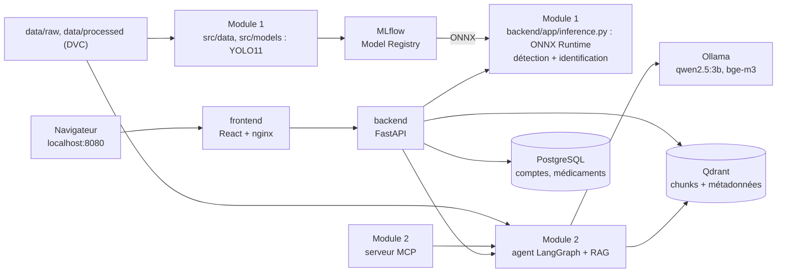
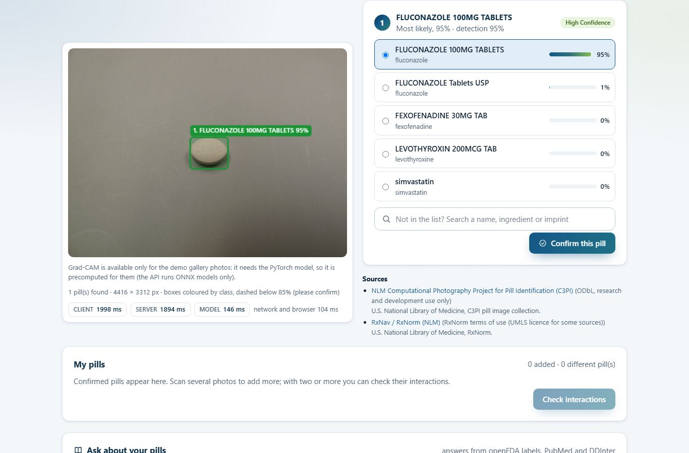
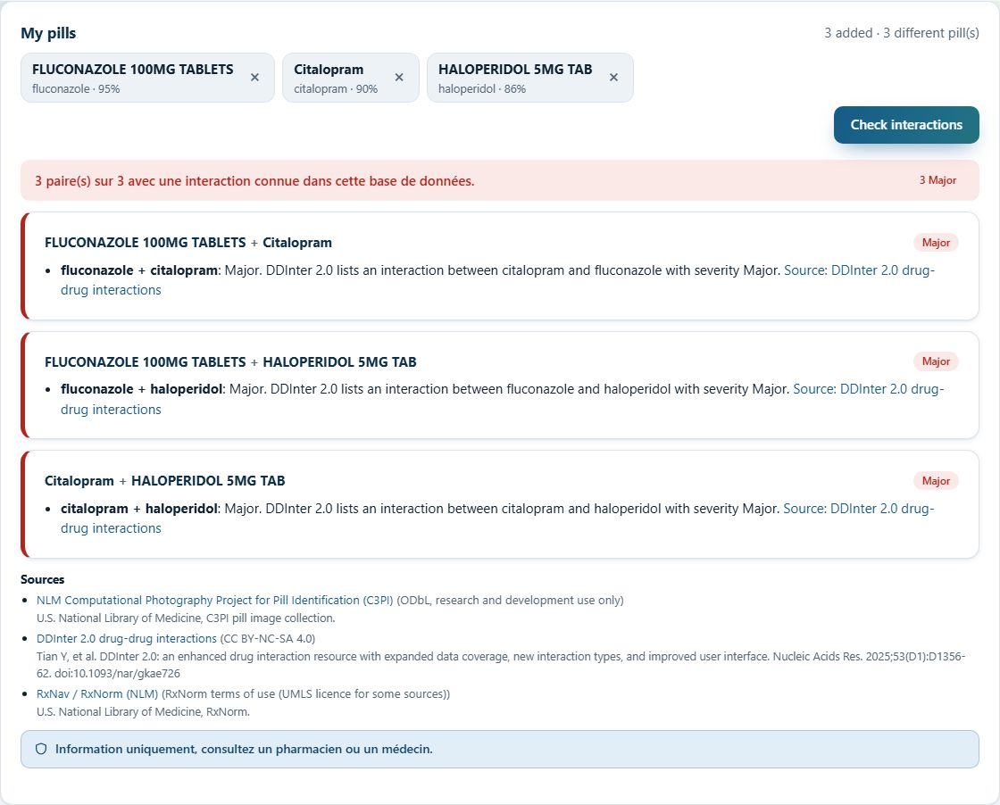
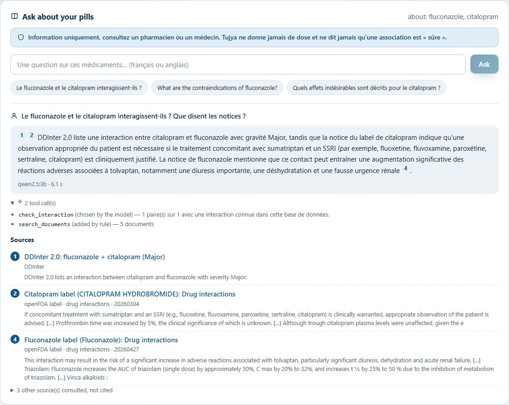
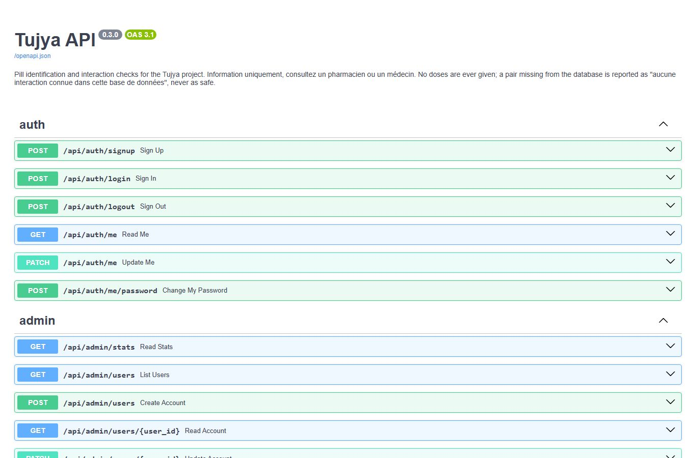

# Tujya

[](https://github.com/melekbouabid/syRX/actions/workflows/ci-tests.yml)
[](https://github.com/melekbouabid/syRX/actions/workflows/docker-build.yml)

**Tujya** est une application de sécurité du médicament. On photographie un ou plusieurs
comprimés (upload ou webcam) : un modèle YOLO **détecte** chaque comprimé, un classifieur
entraîné par *transfer learning* l'**identifie** parmi 380 comprimés du jeu public NLM C3PI,
avec sa confiance. Tujya relie chaque comprimé à ses principes actifs, vérifie leurs
**interactions** dans DDInter, puis un agent LangGraph répond aux questions de suivi par
**RAG** sur les notices openFDA, des résumés PubMed et DDInter, en **citant ses sources**.
Projet étudiant solo, évalué dans deux modules : **Industrialisation Vision & MLOps** et
**AI Engineering**.

> **Information uniquement : consultez un pharmacien ou un médecin.** Tujya ne donne jamais
> de posologie et ne dit jamais qu'une association est « sûre » : au mieux, « aucune
> interaction connue dans cette base de données ». L'identification d'un comprimé est une
> suggestion, jamais une certitude, et la confiance est toujours affichée.

## Les deux modules

| | Module 1 : Vision & MLOps | Module 2 : AI Engineering |
|---|---|---|
| Code | [src/data/](src/data/), [src/models/](src/models/), [backend/app/inference.py](backend/app/inference.py) | [src/data/corpus/](src/data/corpus/), [src/rag/](src/rag/), [src/agent/](src/agent/), [src/mcp_server/](src/mcp_server/), [src/benchmark/](src/benchmark/) |
| Documentation | [docs/module1/](docs/module1/README.md) | [docs/module2/](docs/module2/README.md) |
| Exigences → fichiers | [README du module 1](docs/module1/README.md#exigences-du-module-et-fichiers-correspondants) | [README du module 2](docs/module2/README.md#exigences-du-module-et-fichiers-correspondants) |
| Rapport technique | [PDF](docs/module1/rapport_module1_vision_mlops.pdf) · [Markdown](docs/module1/rapport_module1_vision_mlops.md) | [PDF](docs/module2/rapport_module2_ai_engineering.pdf) · [Markdown](docs/module2/rapport_module2_ai_engineering.md) |
| Contenu | entraînement YOLO (détection + identification), MLflow, ONNX, chaîne de scan servie | corpus, RAG Qdrant (page Documents), agent LangGraph, outils et MCP, benchmark |
| Évaluation | démonstration technique en direct | dépôt et commits, rapport, démonstration |

L'application web commune ([backend/](backend/), [frontend/](frontend/)) est décrite dans
[docs/app.md](docs/app.md) ; le travail en plus des exigences dans [docs/bonus/](docs/bonus/README.md).

## Architecture



Détail des composants, des flux et des dépendances : [docs/architecture.md](docs/architecture.md).

## Aperçu

| Scan d'une photo : boîte, nom, top-5 | Interactions entre comprimés confirmés |
|---|---|
|  |  |
| **Réponse de l'agent avec citations** | **Swagger de l'API** |
|  |  |

Toutes les captures : [docs/screenshots/](docs/screenshots/) (scan, webcam, cas incertain,
chat, dose refusée, MLflow, toxicité).

## Démarrage rapide

Prérequis : Docker Desktop (GPU NVIDIA conseillé pour Ollama), les données DVC et les
modèles publiés.

```bash
dvc pull                       # données (images C3PI, tables DDInter, corpus RAG), remote local
# modèles ONNX dans models/ : python -m src.models.publish  (venv d'entraînement .venv-train)
docker compose up -d --build   # toute l'application, depuis la racine du dépôt
```

| Adresse | Contenu |
|---|---|
| <http://localhost:8080> | site (Scanner, chat « Ask about your pills », Toxicity) |
| <http://localhost:8080/docs> | Swagger de l'API (aussi <http://localhost:8000/docs>) |
| <http://localhost:5000> | MLflow (expériences et Model Registry) |

| Compte de démonstration | Mot de passe | Accès |
|---|---|---|
| `user@gmail.com` | `user` | utilisateur : Scanner, chat, Toxicity |
| `admin@gmail.com` | `admin` | administration (à changer avant tout autre usage) |

Au premier démarrage, `rag-init` télécharge les modèles Ollama puis indexe le corpus dans
Qdrant (quelques minutes ; tableau de bord <http://localhost:6333/dashboard>) ; scan et interactions marchent sans attendre. Sans GPU :
`docker compose -f docker-compose.yml -f infra/docker/ollama/cpu.yml up -d`. Arrêt :
`docker compose down` (garde les volumes). Développement sans Docker : [docs/app.md](docs/app.md) ;
script de la soutenance : [docs/demo.md](docs/demo.md).

## Exigences des modules

Une exigence n'est marquée faite que lorsqu'elle est réellement satisfaite. Le détail
(fichiers exacts) est dans le README de chaque module.

### Module 1 : Industrialisation Vision & MLOps

| Exigence | État | Où |
|---|:---:|---|
| Détection des comprimés avec YOLOv8/v11 | ✅ | [src/models/](src/models/) (YOLO11s, champion de l'étape 2.2 ; baseline YOLO11n) |
| Identification de chaque comprimé par transfer learning | ✅ | [src/models/](src/models/) (EfficientNetV2-S préentraîné sur ImageNet, 380 classes, champion de l'étape 2.3 ; baseline YOLO11s-cls) |
| Backend FastAPI asynchrone, schémas Pydantic, Swagger sur `/docs` | ✅ | [backend/](backend/), [backend/app/inference.py](backend/app/inference.py) ; endpoints du guide `GET /health`, `GET /model/metadata`, `POST /predict`, `POST /predict/visualize` (400 / 503) : [backend/app/routers/vision.py](backend/app/routers/vision.py), [docs/api.md](docs/api.md#endpoints-du-guide-du-module-1-sans-compte) |
| Frontend React du guide : framework CSS (Tailwind), glisser-déposer, galerie d'exemples du split de test, webcam en inférence continue, barres de probabilité animées, boîtes colorées par classe, latence client et serveur (ms), modèle champion affiché | ✅ | [frontend/src/pages/ScanPage.tsx](frontend/src/pages/ScanPage.tsx), [services/api.ts](frontend/src/services/api.ts), [docs/app.md](docs/app.md#page-scanner-guide-du-module-1-étape-26) (captures 01 à 07, 18 à 21) |
| Grad-CAM (explicabilité du classifieur) | ✅ | précalculé avec les poids PyTorch du classifieur servi pour la galerie de démo, affiché dans le Scanner : [src/utils/gradcam.py](src/utils/gradcam.py), [src/models/gradcam_gallery.py](src/models/gradcam_gallery.py) (étape DVC `gradcam_gallery`), [docs/api.md](docs/api.md#galerie-de-démo-et-grad-cam) (D104) |
| Boîtes de médicaments (remarque 18 : Panadol...) : OCR, table des marques sourcée, refus hors distribution, comparaison de moteurs OCR dans MLflow | ✅ | [backend/app/boxes.py](backend/app/boxes.py), [src/models/ocr/](src/models/ocr/), [config/brand_aliases.csv](config/brand_aliases.csv), [docs/module1/boites.md](docs/module1/boites.md) (captures 22 à 26, D108-D112, D115) ; validé sur 11 vraies boîtes sous licence libre (Wikimedia Commons) : 3 Panadol sur 3 -> paracétamol avec sa source, aucun principe actif faux |
| DVC (versionnement des données) | ✅ | [dvc.yaml](dvc.yaml) (données, puis `train_detector`, `train_classifier`, `export_onnx`, `evaluate`), [params.yaml](params.yaml), [docs/infra.md](docs/infra.md) |
| Plus de données et Big Data avec PySpark (demande du professeur) | ✅ | [src/data/spark/](src/data/spark/), cluster Spark de [docker-compose.yml](docker-compose.yml), [docs/module1/big_data.md](docs/module1/big_data.md) (data card) |
| Comparaison de détecteurs (YOLOv8n/s, YOLO11s, YOLOv10n, Faster R-CNN) et recherche d'hyperparamètres Optuna, une branche par modèle | ✅ | branches `experiment/detector-*`, 8 à 12 essais Optuna par modèle (runs enfants MLflow), tableau et figure précision / latence / taille : [docs/module1/kaggle_detecteurs.md](docs/module1/kaggle_detecteurs.md) (YOLO11s champion, YOLOv10n challenger, D98) |
| Comparaison de classifieurs (baseline CNN maison, ResNet-50, EfficientNetV2-S, ConvNeXt-Tiny, ViT-B/16, YOLO11s-cls), recherche d'hyperparamètres Optuna, Grad-CAM, une branche par modèle | ✅ | six runs Kaggle (T4, 12 à 16 essais Optuna chacun), une branche `experiment/classifier-*` par modèle (poids DVC) ; champion **EfficientNetV2-S** (top-1 0,909 sur 380 classes, contre 0,183 pour le classifieur v1), challenger ResNet-50, CNN maison 0,367 : [docs/module1/kaggle_classifieurs.md](docs/module1/kaggle_classifieurs.md) (D99-D103, D120) |
| MLflow : tracking des expériences | ✅ | expérience `tujya-vision`, runs tracés (`git_commit`, `dvc_rev`, `dataset`, `seed`, requirements + `dvc.lock`) : [src/utils/mlflow_utils.py](src/utils/mlflow_utils.py), [docs/module1/mlflow.md](docs/module1/mlflow.md) |
| MLflow : Model Registry | ✅ | `tujya-pill-detector`, `tujya-pill-classifier`, alias `champion` / `challenger` / `served`, `promote_if_better` ; détecteur : YOLO11s champion, YOLOv10n challenger ; classifieur : EfficientNetV2-S champion, ResNet-50 challenger |
| Export ONNX et inférence ONNX Runtime | ✅ | [backend/app/inference.py](backend/app/inference.py) |
| Optimisation : quantification FP16 / INT8, comparaison précision / latence / taille | ✅ | [src/models/quantize.py](src/models/quantize.py), [src/models/optimize.py](src/models/optimize.py), [docs/module1/optimisation_onnx.md](docs/module1/optimisation_onnx.md) (détecteur YOLO11s et classifieur EfficientNetV2-S servis en FP32 : le FP16 n'est pas assez plus rapide sur ce CPU, l'INT8 est plus lent et moins précis) |
| Suivi de la dérive des données en production (guide de mi-parcours) | ✅ | huit statistiques par photo scannée (jamais l'image), test de Kolmogorov-Smirnov et PSI contre la référence DVC `drift_reference`, `GET /monitoring/drift`, page Monitoring et bandeau du Scanner, démonstration reproductible : [backend/app/drift.py](backend/app/drift.py), [src/data/drift_demo.py](src/data/drift_demo.py), [docs/module1/derive.md](docs/module1/derive.md) (D122) |
| Docker Compose | ✅ | [docker-compose.yml](docker-compose.yml) |
| Git avancé : branches, tags annotés, hooks (secrets, messages de commit) | ✅ | [docs/git_workflow.md](docs/git_workflow.md), [tools/hooks/](tools/hooks/) |
| GitHub Actions CI/CD | ✅ | [ci-tests.yml](.github/workflows/ci-tests.yml) (flake8, black, ESLint, pytest, Vitest, build), [docker-build.yml](.github/workflows/docker-build.yml) (images multi-stage + test de fumée), [docs/cd.md](docs/cd.md) |
| Soutenance pratique (démonstration technique en direct) | ⬜ | [docs/demo.md](docs/demo.md) |

### Module 2 : AI Engineering

| Exigence | État | Où |
|---|:---:|---|
| RAG avec gestion des documents, métadonnées, citations, documentation | ✅ | [src/data/corpus/](src/data/corpus/), [src/rag/](src/rag/), [docs/module2/rag.md](docs/module2/rag.md) |
| Recherche avancée : BM25 sparse et hybride dans Qdrant, reranker cross-encoder (bge-reranker-base), réécriture de requête, filtres de métadonnées, comparés dans le benchmark | ✅ | [src/rag/](src/rag/) (sparse.py, rerank.py, rewrite.py), [docs/module2/benchmark.md](docs/module2/benchmark.md#recherche-avancée-étape-32) (hybride + réécriture + reranker : Recall@5 0,965, MRR 0,889 ; D116-D118) |
| Base vectorielle consultable : Qdrant (tableau de bord), page « Documents » et `GET /api/documents` (documents indexés, métadonnées, chunks) | ✅ | [src/rag/qdrant_store.py](src/rag/qdrant_store.py), [src/rag/documents.py](src/rag/documents.py), [backend/app/routers/documents.py](backend/app/routers/documents.py), [DocumentsPage.tsx](frontend/src/pages/DocumentsPage.tsx), [docs/module2/rag.md](docs/module2/rag.md#consulter-les-documents-indexés) (captures 27 à 29, D113-D114) |
| Tool calling / MCP | ✅ | [src/agent/tools.py](src/agent/tools.py), [src/mcp_server/](src/mcp_server/) |
| LangChain et/ou LangGraph | ✅ | [src/agent/graph.py](src/agent/graph.py) |
| Benchmark de la récupération et de la génération | ✅ | [src/benchmark/](src/benchmark/) |
| Interface web | ✅ | chat dans [frontend/](frontend/) |
| Dépôt GitHub documenté avec commits réguliers | ✅ | `git log`, tags git, [docs/git_workflow.md](docs/git_workflow.md) (branches, Conventional Commits, hooks) |
| Rapport technique | ✅ | [rapport du module 2](docs/module2/rapport_module2_ai_engineering.pdf) |
| Démonstration | ⬜ | [docs/demo.md](docs/demo.md) |

## Résultats

| Vision (split de test C3PI, photos jamais vues) | Résultat |
|---|---:|
| Détection YOLO11n : mAP50 / mAP50-95 | 0,972 / 0,861 |
| Identification YOLO11s-cls (150 classes) : top-1 / top-5 | 93,5 % / 98,1 % |
| Bout en bout dans l'API (ONNX Runtime, 600 photos) : top-1 / top-5 | 89,3 % / 95,8 % |
| Seuil 0,85 : photos acceptées sans confirmation / justes parmi elles | 70,5 % / 99,3 % |

| RAG (88 questions FR/EN, MLflow `tujya-rag`) | Résultat |
|---|---:|
| Récupération dense bge-m3 + filtre : Recall@5 / MRR (83 questions ; identique sur Qdrant et pgvector) | 0,928 / 0,852 |
| Phrases citées soutenues par leur source (juge local) | 94,0 % |
| Doses chiffrées / « sûr » dans les réponses ; questions de dose refusées | 0 / 0 ; 2/2 |
| RAGAS : fidélité / précision du contexte | 0,979 / 0,809 |
| Temps de réponse moyen (RTX 2050) | 4,7 s |

Détails : [module 1](docs/module1/README.md#résultats),
[module 2](docs/module2/README.md#résultats-du-benchmark). Bonus : toxicité Tox21,
ROC-AUC moyen 0,725 en test (split par scaffold) ([docs/bonus/](docs/bonus/README.md)).

## Organisation du dépôt

Arborescence du guide des modules, commune aux deux modules (décision D86).

```
src/                      code des deux modules (paquet Python `src`)
  data/                   C3PI (index, téléchargement, boîtes automatiques, jeux YOLO), corpus RAG,
                          pipeline de collecte polie (tujya_data : DDInter, PubMed, openFDA)
  models/                 entraînement, évaluation, export ONNX, publication ; toxicity/ (bonus Tox21)
  rag/  agent/            récupération (Qdrant, dense + BM25), catalogue des documents ; agent LangGraph, outils, sécurité
  mcp_server/  benchmark/ serveur MCP ; benchmark de la récupération et de la génération
  utils/                  utilitaires partagés
backend/                  API FastAPI : Dockerfile, requirements.txt, app/ (main, schemas, inference, routers), tests/
frontend/                 site React : Dockerfile, package.json, src/ (components, services/api, pages)
tests/                    tests du code de src/ (data, models, rag, agent, mcp_server)
notebooks/                notebooks d'entraînement (Kaggle)
data/raw  data/processed  données (DVC, jamais dans git) ; data/rag : collecte des sources RAG
models/                   modèles servis par l'API (jamais dans git)
config/                   listes tenues à la main : 150 classes, split, alias, galerie, réglages du pipeline
docs/                     architecture, API, infra, CD, démo, décisions ; module1/, module2/, bonus/, data_pipeline/
infra/                    MLflow, initialisation PostgreSQL, variante Ollama sans GPU
tools/                    hooks Git du dépôt (secrets, messages de commit) et leurs tests
docker-compose.yml        toute l'application en une commande
dvc.yaml  dvc.lock        étapes DVC : prepare (module 1), rag_corpus (module 2)
pyproject.toml            paquet, dépendances, pytest et mypy ; requirements-dev.txt : venv unique .venv
ruff.toml                 règles de lint communes à tout le code Python
.github/workflows/        ci-tests.yml (lint, tests, messages de commit, build du site), docker-build.yml (images testées, non publiées)
```

## Technologies

| Domaine | Outils |
|---|---|
| Vision | Ultralytics YOLO11 (détection, classification), PyTorch (CUDA), OpenCV, ONNX, ONNX Runtime |
| MLOps | MLflow 3.17 (tracking, Model Registry), DVC 3.67 (remote local), Docker Compose, GitHub Actions |
| LLM et RAG | LangGraph, LangChain, Ollama (qwen2.5:3b, bge-m3), Qdrant 1.20, PostgreSQL 16 (+ pgvector, ancien index), BM25, MCP (SDK officiel), RAGAS |
| Application | FastAPI, Pydantic, SQLAlchemy, React 19, Vite, TypeScript, nginx, Playwright (captures) |
| Données | NLM C3PI, RxNav, DDInter 2, openFDA, PubMed, Tox21 |
| Qualité | pytest (plus de 300 tests), ruff, mypy, ESLint, pre-commit (hooks de secrets et de messages de commit) |

## Usage local et sécurité

L'application tourne **uniquement sur ce PC** : aucun déploiement public, aucun tunnel,
aucune image publiée ; tous les ports de Docker Compose sont liés à `127.0.0.1`, le serveur
MCP HTTP n'accepte que les adresses de bouclage. Les secrets sont dans `.env` (ignoré par
git, modèle [.env.example](.env.example)). Détails : [docs/infra.md](docs/infra.md).

Les règles de sécurité des réponses sont appliquées dans le code, les prompts et l'interface :
jamais de dose, jamais « sûr », horaires répétés seulement si la source les donne, source
toujours citée, avertissement toujours affiché, confiance de l'identification toujours
visible ([src/agent/safety.py](src/agent/safety.py), tests dans
[tests/](tests/)).

## Données, licences et sources

Les données ne sont **jamais** dans git (plusieurs sources interdisent la redistribution) :
elles sont sous `data/`, versionnées par DVC avec un remote local hors du dépôt.

| Jeu de données | Licence | Usage dans Tujya |
|---|---|---|
| [NLM C3PI](https://catalog.data.gov/dataset/computational-photography-project-for-pill-identification-c3pi) ([fichiers](https://data.lhncbc.nlm.nih.gov/public/Pills/)) | ODbL ; recherche et développement uniquement | images de comprimés et métadonnées (module 1) |
| [ePillID](https://arxiv.org/abs/2005.14288) | article | benchmark de référence pour l'identification |
| [DDInter 2](https://ddinter2.scbdd.com/) | CC BY-NC-SA 4.0 (académique, non commercial) | interactions entre principes actifs |
| [RxNorm / RxNav](https://lhncbc.nlm.nih.gov/RxNav/APIs/) | conditions UMLS / RxNorm | comprimé -> principe(s) actif(s) |
| [openFDA drug labels](https://open.fda.gov/apis/drug/label/) | CC0 / domaine public | corpus RAG : notices officielles |
| [PubMed (E-utilities)](https://www.ncbi.nlm.nih.gov/books/NBK25501/) | conditions NLM | corpus RAG : résumés d'articles |
| Tox21 (copie MoleculeNet / DeepChem) | aucune licence explicite trouvée (données publiques, citées) | bonus toxicité |

Sources du pipeline de collecte et registre complet : [docs/data_pipeline/README.md](docs/data_pipeline/README.md)
et [docs/data_pipeline/LICENSES.md](docs/data_pipeline/LICENSES.md). Jeu C3PI en détail :
[docs/module1/dataset_c3pi.md](docs/module1/dataset_c3pi.md).

## Documentation

- Projet : [architecture](docs/architecture.md), [API](docs/api.md), [infrastructure et DVC](docs/infra.md),
  [CD](docs/cd.md), [décisions](docs/decisions.md), [feuille de route](docs/roadmap.md).
- Soutenance : [script de démonstration](docs/demo.md), [questions probables du jury](docs/questions_jury.md).
- Règles du projet (sécurité des réponses, usage local) : [docs/project_rules.md](docs/project_rules.md).
- Historique : `git log` et tags git (`v1.0-avant-restructuration` : état du projet d'origine avant la restructuration).

## Licence

Code publié pour consultation dans le cadre d'une évaluation académique, tous droits réservés :
voir [LICENSE](LICENSE) (les données gardent leurs propres licences, section précédente).

## Auteur

**Melek Bouabid**, projet étudiant réalisé seul.
