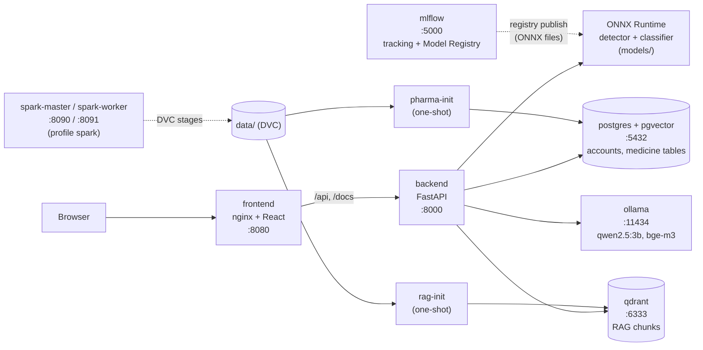
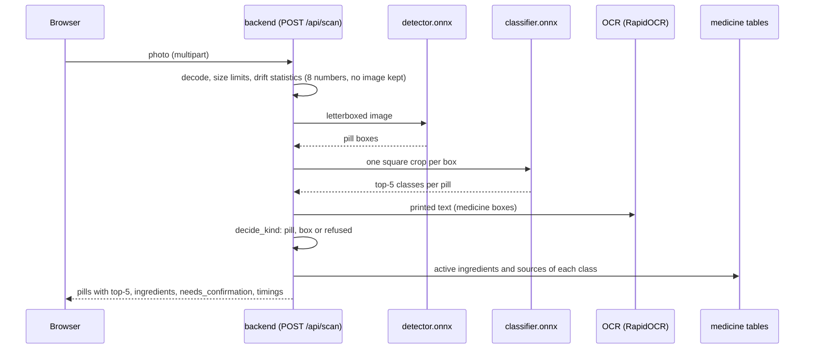
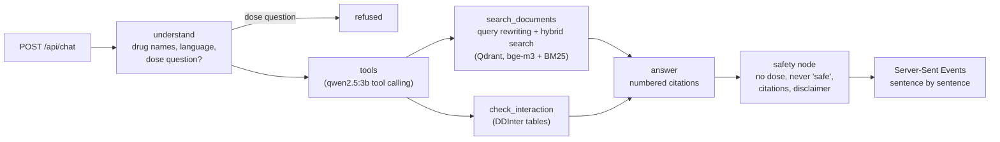

# Architecture

Tujya is one web application built from the work of two modules: a vision pipeline that
identifies pills (module 1, MLOps) and a cited RAG agent that answers questions about them
(module 2, AI engineering). Everything runs locally with Docker Compose; every published port
is bound to `127.0.0.1`.

## Services

| Service | Image | Host address | Role |
|---|---|---|---|
| `frontend` | [frontend/Dockerfile](../frontend/Dockerfile) (Vite build, nginx) | http://localhost:8080 | web app; proxies `/api`, `/docs`, `/openapi.json` to the backend |
| `backend` | [backend/Dockerfile](../backend/Dockerfile) | http://localhost:8000 (Swagger: `/docs`) | FastAPI: scan, interactions, chat, documents, accounts |
| `postgres` | `pgvector/pgvector:pg16` | localhost:5432 | accounts, medicine tables, MLflow store |
| `mlflow` | [infra/mlflow/Dockerfile](../infra/mlflow/Dockerfile) | http://localhost:5000 | experiment tracking, Model Registry, Prompt Registry |
| `adminer` | `adminer:6.3.1` | http://localhost:8081 | web UI of PostgreSQL (login below) |
| `qdrant` | `qdrant/qdrant:v1.20.0` | http://localhost:6333/dashboard | vector index of the RAG (dense + BM25 sparse); the bare port only returns a JSON version string |
| `ollama` | `ollama/ollama:0.40.12` | http://localhost:11434 | local LLM and embeddings (GPU when available) |
| `pharma-init` | backend image | none | reloads the medicine tables from `data/processed/pharma`, then exits |
| `rag-init` | backend image | none | pulls the Ollama models and indexes the corpus in Qdrant, then exits |
| `spark-master`, `spark-worker` | [infra/spark](../infra/spark/) | http://localhost:8090, :8091 (job UI :4040) | PySpark jobs, only with `--profile spark` |

Both databases in the browser:

- PostgreSQL: http://localhost:8081 (Adminer). System `PostgreSQL`, Server `postgres`,
  Username `tujya`, Password: the value of `POSTGRES_PASSWORD` in `.env` (default `tujya`),
  Database `tujya` (app tables) or `mlflow` (MLflow tracking).
- Qdrant: http://localhost:6333/dashboard (the bare port only returns a JSON version string).

The project name (prefix of containers, volumes and images) comes from `COMPOSE_PROJECT_NAME`
in `.env` ([.env.example](../.env.example)). `docker compose down` keeps the volumes.

## Flow of a photo

Code: [backend/app/routers/scan.py](../backend/app/routers/scan.py),
[backend/app/inference.py](../backend/app/inference.py),
[backend/app/boxes.py](../backend/app/boxes.py), [backend/app/drift.py](../backend/app/drift.py).
With two or more pills, `POST /api/interactions` looks up every pair of ingredients in the
DDInter tables. The course endpoints (`/predict`, `/predict/visualize`) run the same detector
and classifier without accounts or medicine tables ([api.md](api.md)).

## Flow of a question

Code: [src/agent/graph.py](../src/agent/graph.py), [src/agent/tools.py](../src/agent/tools.py),
[src/rag/retrieval.py](../src/rag/retrieval.py), [src/agent/safety.py](../src/agent/safety.py).
The same tools are exposed to any MCP client by [src/agent/mcp_server.py](../src/agent/mcp_server.py).

## Code layout and environments

| Folder | Role | Runs in |
|---|---|---|
| [src/data](../src/data/) | C3PI download, auto-labels, datasets, Spark jobs, drift reference, polite data pipeline | `.venv` / `.venv-train`, Spark containers |
| [src/models](../src/models/) | training, Kaggle runners, comparison, ONNX export, quantization, Registry | `.venv-train` (PyTorch), Kaggle GPU |
| [src/rag](../src/rag/) | corpus, chunking, Qdrant index, retrieval, reranking, query rewriting | backend |
| [src/agent](../src/agent/) | LangGraph agent, tools, safety rules, MCP server | backend |
| [src/evaluation](../src/evaluation/) | retrieval and generation benchmarks | `.venv` |
| [backend/app](../backend/app/) | FastAPI application | `backend` container |
| [frontend](../frontend/) | React application | `frontend` container |

Two Python environments: `.venv` (API, `src/` except training, every test suite; installed
from [requirements-dev.txt](../requirements-dev.txt)) and `.venv-train` (PyTorch, Ultralytics,
DVC; [src/models/requirements-train.txt](../src/models/requirements-train.txt)). The backend
image does not contain PyTorch: it serves ONNX models only.

## CI

[.github/workflows/ci-tests.yml](../.github/workflows/ci-tests.yml) runs ruff, black, flake8,
mypy, ESLint and every test suite. [.github/workflows/docker-build.yml](../.github/workflows/docker-build.yml)
builds the multi-stage images and smoke-tests them; nothing is published, the app runs only on
the owner's PC.
