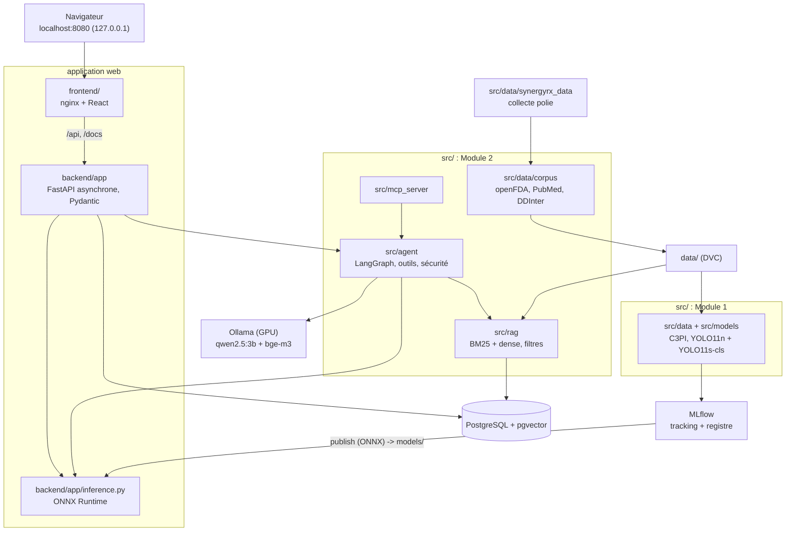

# Architecture

Tujya est une seule application (`backend/` et `frontend/`) qui assemble le travail de deux
modules notés séparément, dans l'arborescence imposée par le guide des modules (`src/`,
`backend/`, `frontend/`, `data/raw`, `data/processed`, `notebooks/`). Ce document décrit les
composants, les flux, les dépendances entre dossiers et les environnements. Choix détaillés :
[docs/decisions.md](decisions.md) (D79 à D82, puis D86 pour l'organisation du dépôt).

## Vue d'ensemble

Version image (utilisée par les rapports) : [docs/assets/architecture.png](assets/architecture.png),
source [docs/diagrams/architecture.mmd](diagrams/architecture.mmd).

## Composants

| Dossier | Rôle | Exécution |
|---|---|---|
| [backend/](../backend/) | API FastAPI : configuration, bases (comptes en SQLite ou PostgreSQL, médicaments et interactions dans PostgreSQL), comptes et sessions, administration, routes ; importe le code de `src/` | conteneur `backend` (et `pharma-init`, `rag-init`) |
| [frontend/](../frontend/) | site React : Scanner (upload, webcam, boîtes, interactions), chat, Toxicity, admin | conteneur `frontend` (nginx) |
| [src/data/](../src/data/) | sélection C3PI, téléchargement, étiquetage automatique, jeux YOLO (étape DVC `prepare`) | sur le PC (venv d'entraînement) |
| [src/models/](../src/models/) | entraînement, évaluation, export ONNX, Model Registry, publication ; modèle Tox21 (bonus) | sur le PC (venv avec PyTorch, GPU) |
| [backend/app/inference.py](../backend/app/inference.py) | chaîne de scan ONNX Runtime (détecteur, recadrage, classifieur) | dans l'API |
| [src/data/corpus/](../src/data/corpus/) | principes actifs, interactions DDInter, notices openFDA, résumés PubMed, chunks | sur le PC (venv du projet), étape DVC `rag_corpus` |
| [src/rag/](../src/rag/) | embeddings, stockage pgvector, recherche, indexation | dans l'API ; indexation par `rag-init` |
| [src/agent/](../src/agent/) | graphe LangGraph, outils, règles de sécurité | dans l'API |
| [src/mcp_server/](../src/mcp_server/) | les mêmes outils par MCP | processus séparé (stdio ou HTTP local) |
| [src/benchmark/](../src/benchmark/) | questions, scripts, résultats | sur le PC |
| [src/models/toxicity/](../src/models/toxicity/) | toxicité Tox21, bonus ([docs/bonus/](bonus/README.md)) : outil de l'agent, route, page | dans l'API ; entraînement sur le PC |
| [src/data/synergyrx_data/](../src/data/synergyrx_data/) | pipeline SynergyRx ([docs/data_pipeline/](data_pipeline/README.md)) : client HTTP poli, connecteurs, manifeste | sur le PC (venv du projet) |
| [tests/](../tests/), [backend/tests/](../backend/tests/) | tests du code de `src/` et de l'API | `pytest` à la racine et dans `backend/` |
| [infra/](../infra/) | images et réglages des services MLflow, PostgreSQL, Ollama | Docker Compose |

## Flux principaux

**Scan** (module 1). Le site envoie la photo à `POST /api/scan`. L'API la décode avec des
limites de taille, le détecteur ONNX propose des boîtes, chaque comprimé est recadré comme à
l'entraînement puis identifié par le classifieur ONNX. Les principes actifs de chaque classe
viennent des tables PostgreSQL. Sous le seuil de confiance 0,85, le site demande une
confirmation.

**Vérification** (commune). Avec au moins deux comprimés, `POST /api/interactions` cherche
chaque paire de principes actifs dans les tables DDInter. La réponse donne la sévérité, la
description et la source ; une paire absente reçoit « aucune interaction connue dans cette
base de données », jamais « sûr ».

**Question** (module 2). `POST /api/chat` lance le graphe LangGraph : compréhension, choix des
outils (appel d'outils d'Ollama complété par des règles), récupération dense bge-m3 filtrée
par principe actif, réponse avec citations numérotées, puis contrôle de sécurité (doses,
« sûr », horaires non sourcés, citations, avertissement). La réponse arrive en flux SSE,
phrase par phrase.

**MLOps** (module 1). Les images C3PI et les jeux préparés sont versionnés par DVC (étape
`prepare`). L'entraînement journalise dans MLflow et enregistre les modèles dans le Model
Registry ; `publish` copie les versions enregistrées (ONNX) dans `models/`, monté en lecture
seule dans l'API. La CI teste chaque paquet, la CD construit et teste les images sans les
publier.

## Dépendances entre dossiers

- `backend/app` importe `src.rag`, `src.agent` et `src.models.toxicity` ; la chaîne de scan
  est dans l'API (`app.inference`). Le code de `src/` importe le cœur de l'application
  seulement pour ce qui est partagé : configuration (`app.config`), tables des médicaments (`app.pharma`,
  `app.medicines`). Les outils de l'agent réutilisent les fonctions des routes de scan et
  d'interactions, pour que l'API, l'agent et le serveur MCP donnent exactement la même
  réponse.
- `src.data.corpus` dépend du pipeline (`src.data.synergyrx_data`), jamais l'inverse.
- L'entraînement (`src.data.prepare`, `src.models.train`, ...) tourne dans son propre venv
  (PyTorch et Ultralytics) : l'API n'en importe rien, elle ne lit que les fichiers ONNX
  publiés.

`src` est un paquet Python importé depuis la racine du dépôt : l'installation éditable de
[pyproject.toml](../pyproject.toml) met la racine et `backend/` sur le chemin du venv du
projet ; l'image Docker fait de même avec `PYTHONPATH` et la même disposition sous `/tujya`.

## Environnements Python

| Venv (ignoré par git) | Pour | Installation |
|---|---|---|
| `.venv` | API, code de `src/` hors entraînement (RAG, agent, MCP, benchmark, corpus, pipeline), toutes les suites de tests, ruff, mypy | `uv venv .venv -p 3.12 && uv pip install -p .venv -r requirements-dev.txt` depuis la racine |
| `.venv-train` | entraînement (PyTorch, Ultralytics), MLflow, DVC | `uv venv .venv-train -p 3.12 && uv pip install -p .venv-train -r src/models/requirements-train.txt` depuis la racine |

## Conteneurs (docker-compose.yml)

| Service | Image | Port (hôte, 127.0.0.1) |
|---|---|---|
| `postgres` | `pgvector/pgvector:pg16` | 5432 |
| `mlflow` | [infra/docker/mlflow](../infra/docker/mlflow/Dockerfile) | 5000 |
| `ollama` | `ollama/ollama:0.40.12` (GPU NVIDIA) | 11434 |
| `pharma-init`, `rag-init` | image du backend, tâches ponctuelles | aucun |
| `backend` | [backend/Dockerfile](../backend/Dockerfile) | 8000 |
| `frontend` | [frontend/Dockerfile](../frontend/Dockerfile) | 8080 |

Tout est lié à `127.0.0.1` : l'application ne tourne que sur ce PC. Détails, volumes et
remote DVC : [docs/infra.md](infra.md).
