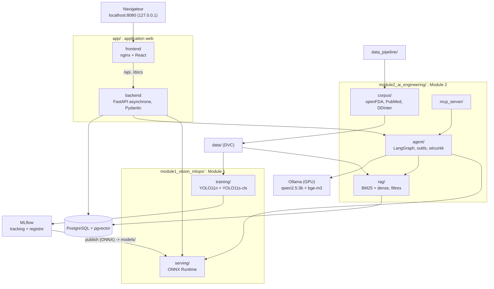

# Architecture

Tujya est une seule application (`app/`) qui assemble le travail de deux modules notés
séparément. Ce document décrit les composants, les flux, les dépendances entre dossiers et
les environnements. Choix détaillés : [decisions.md](decisions.md) (D79 à D82 pour
l'organisation du dépôt).

## Vue d'ensemble

Version image (utilisée par les rapports) : [assets/architecture.png](assets/architecture.png),
source [diagrams/architecture.mmd](diagrams/architecture.mmd).

## Composants

| Dossier | Rôle | Exécution |
|---|---|---|
| [app/backend/](../app/backend/) | API FastAPI : configuration, bases (comptes en SQLite ou PostgreSQL, médicaments et interactions dans PostgreSQL), comptes et sessions, administration, routes ; importe le code des modules | conteneur `backend` (et `pharma-init`, `rag-init`) |
| [app/frontend/](../app/frontend/) | site React : Scanner (upload, webcam, boîtes, interactions), chat, Toxicity, admin | conteneur `frontend` (nginx) |
| [module1_vision_mlops/training/](../module1_vision_mlops/training/) | sélection C3PI, étiquetage automatique, entraînement, évaluation, export ONNX, Model Registry, publication | sur le PC (venv avec PyTorch, GPU) |
| [module1_vision_mlops/serving/](../module1_vision_mlops/serving/) | chaîne de scan ONNX Runtime (détecteur, recadrage, classifieur) | dans l'API |
| [module2_ai_engineering/corpus/](../module2_ai_engineering/corpus/) | principes actifs, interactions DDInter, notices openFDA, résumés PubMed, chunks | sur le PC (venv du pipeline), étape DVC `rag_corpus` |
| [module2_ai_engineering/rag/](../module2_ai_engineering/rag/) | embeddings, stockage pgvector, recherche, indexation | dans l'API ; indexation par `rag-init` |
| [module2_ai_engineering/agent/](../module2_ai_engineering/agent/) | graphe LangGraph, outils, règles de sécurité | dans l'API |
| [module2_ai_engineering/mcp_server/](../module2_ai_engineering/mcp_server/) | les mêmes outils par MCP | processus séparé (stdio ou HTTP local) |
| [module2_ai_engineering/benchmark/](../module2_ai_engineering/benchmark/) | questions, scripts, résultats | sur le PC |
| [bonus/](../bonus/) | toxicité Tox21 (outil de l'agent, route, page) et étude de synergie | dans l'API ; entraînement sur le PC |
| [data_pipeline/](../data_pipeline/) | pipeline SynergyRx : client HTTP poli, connecteurs, manifeste | sur le PC (venv du pipeline) |
| [infra/](../infra/) | images et réglages des services MLflow, PostgreSQL, Ollama | Docker Compose |

## Flux principaux

**Scan** (module 1). Le site envoie la photo à `POST /api/scan`. L'API la décode avec des
limites de taille, le détecteur ONNX propose des boîtes, chaque comprimé est recadré comme à
l'entraînement puis identifié par le classifieur ONNX. Les principes actifs de chaque classe
viennent des tables PostgreSQL. Sous le seuil de confiance 0,85, le site demande une
confirmation.

**Vérification** (commune). Avec au moins deux comprimés, `POST /api/interactions` cherche
chaque paire de principes actifs dans les tables DDInter. La réponse donne la sévérité, la
description et la source ; une paire absente reçoit « aucune interaction connue dans cette
base de données », jamais « sûr ».

**Question** (module 2). `POST /api/chat` lance le graphe LangGraph : compréhension, choix des
outils (appel d'outils d'Ollama complété par des règles), récupération dense bge-m3 filtrée
par principe actif, réponse avec citations numérotées, puis contrôle de sécurité (doses,
« sûr », horaires non sourcés, citations, avertissement). La réponse arrive en flux SSE,
phrase par phrase.

**MLOps** (module 1). Les images C3PI et les jeux préparés sont versionnés par DVC (étape
`prepare`). L'entraînement journalise dans MLflow et enregistre les modèles dans le Model
Registry ; `publish` copie les versions enregistrées (ONNX) dans `models/`, monté en lecture
seule dans l'API. La CI teste chaque paquet, la CD construit et teste les images sans les
publier.

## Dépendances entre dossiers

- `app/backend/app` importe `module1_vision_mlops.serving`, `module2_ai_engineering.{rag,
  agent}` et `bonus.toxicity`. Les modules importent le cœur de l'application seulement pour
  ce qui est partagé : configuration (`app.config`), tables des médicaments (`app.pharma`,
  `app.medicines`). Les outils de l'agent réutilisent les fonctions des routes de scan et
  d'interactions, pour que l'API, l'agent et le serveur MCP donnent exactement la même
  réponse.
- `module2_ai_engineering.corpus` dépend du pipeline (`synergyrx_data`), jamais l'inverse.
- `module1_vision_mlops/training` est un projet à part (paquet `tujya_vision`, PyTorch et
  Ultralytics) : l'API n'en importe rien, elle ne lit que les fichiers ONNX publiés.

Les dossiers des modules sont des paquets Python importés depuis la racine du dépôt :
l'installation éditable de [app/backend/pyproject.toml](../app/backend/pyproject.toml) met la
racine et `app/backend` sur le chemin du venv du backend ; l'image Docker fait de même avec
`PYTHONPATH` et la même disposition sous `/tujya`.

## Environnements Python

| Venv (ignoré par git) | Pour | Installation |
|---|---|---|
| `app/backend/.venv` | API, tests de l'API, des modules et du bonus, scripts du module 2 | `uv pip install -r requirements-dev.txt` depuis `app/backend` |
| `data_pipeline/.venv` | pipeline, étapes du corpus (module 2), mypy | `uv pip install -e ".[dev]"` depuis `data_pipeline` |
| `module1_vision_mlops/training/.venv` | entraînement, MLflow, DVC | `uv pip install -r requirements.txt` depuis ce dossier |

## Conteneurs (docker-compose.yml)

| Service | Image | Port (hôte, 127.0.0.1) |
|---|---|---|
| `postgres` | `pgvector/pgvector:pg16` | 5432 |
| `mlflow` | [infra/docker/mlflow](../infra/docker/mlflow/Dockerfile) | 5000 |
| `ollama` | `ollama/ollama:0.40.12` (GPU NVIDIA) | 11434 |
| `pharma-init`, `rag-init` | image du backend, tâches ponctuelles | aucun |
| `backend` | [app/backend/Dockerfile](../app/backend/Dockerfile) | 8000 |
| `frontend` | [app/frontend/Dockerfile](../app/frontend/Dockerfile) | 8080 |

Tout est lié à `127.0.0.1` : l'application ne tourne que sur ce PC. Détails, volumes et
remote DVC : [infra.md](infra.md).
