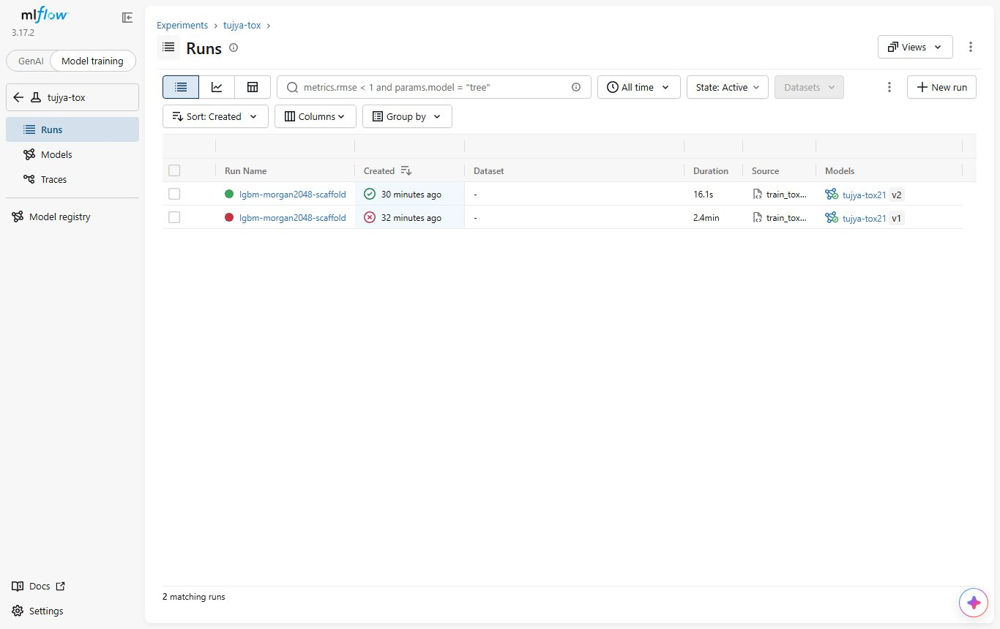
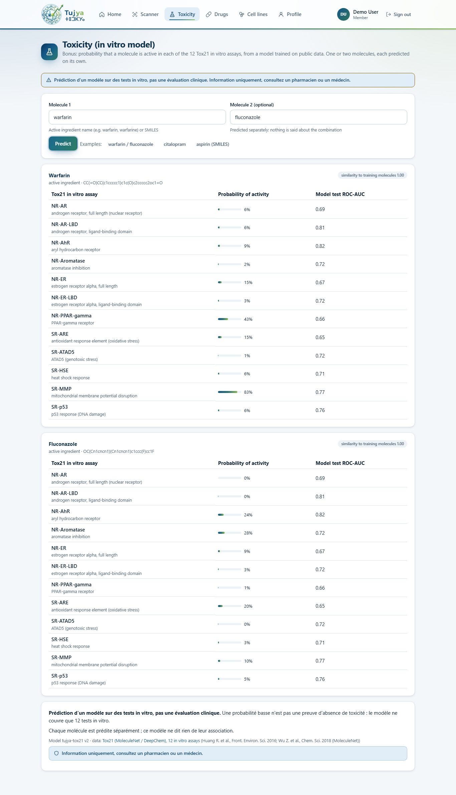

# Bonus : outil de toxicité par molécule (Tox21)

`predict_toxicity` donne, pour une ou deux molécules (nom de principe actif ou SMILES), la
probabilité que chaque molécule soit **active** dans les 12 tests in vitro de Tox21. Chaque
sortie dit qu'il s'agit d'une **« prédiction d'un modèle sur des tests in vitro, pas une
évaluation clinique »**. Chaque molécule est prédite séparément : l'outil ne dit jamais rien
d'un mélange. Décisions : D73 (données et licence) et D74 (conception et sécurité) dans
[docs/decisions.md](../decisions.md).

> Information uniquement, consultez un pharmacien ou un médecin.

## Données et licence

| | |
|---|---|
| Jeu de données | Tox21, copie MoleculeNet : `tox21.csv.gz` de DeepChem (<https://deepchemdata.s3-us-west-1.amazonaws.com/datasets/tox21.csv.gz>), 7 831 molécules, 12 tâches binaires avec étiquettes manquantes |
| Origine | Tox21 Data Challenge 2014 (NIH NCATS, avec NIEHS/NTP, EPA et FDA), <https://tripod.nih.gov/tox21/challenge/> |
| Licence | **Aucun fichier de licence explicite trouvé** pour la copie MoleculeNet ni sur la page du challenge (vérifié le 2026-10-28). Les données ont été produites par des agences fédérales américaines et publiées gratuitement ; le code de DeepChem est sous licence MIT, qui ne couvre pas les données. Traitées comme des données publiques de recherche : citées, utilisées pour ce projet étudiant non commercial, **non redistribuées** (DVC seulement, jamais dans git) (D73) |
| Citation | Huang R. et al., « Tox21 Challenge to Build Predictive Models of Nuclear Receptor and Stress Response Pathways as Mediated by Exposure to Environmental Chemicals and Drugs », Front. Environ. Sci. 2016 ; Wu Z. et al., « MoleculeNet: a benchmark for molecular machine learning », Chem. Sci. 2018 |
| Versionnement | `data/raw/tox21/` (le fichier + `SOURCE.json` : URL, SHA-256 `45d09792…`, taille, date) par `dvc add`, envoyé sur le remote DVC |
| Structures des principes actifs | `config/ingredient_smiles.csv` : un SMILES PubChem par principe actif (82/82), par [`fetch_ingredient_smiles.py`](../../src/models/toxicity/fetch_ingredient_smiles.py) ; PubChem est du domaine public. Alias : valproate -> valproic acid, vitamin B12 -> cyanocobalamin, vitamin B6 -> pyridoxine |

Les 12 tests : NR-AR, NR-AR-LBD (récepteur des androgènes), NR-AhR (récepteur des
hydrocarbures aryliques), NR-Aromatase, NR-ER, NR-ER-LBD (récepteur alpha des œstrogènes),
NR-PPAR-gamma, SR-ARE (stress oxydatif), SR-ATAD5 (stress génotoxique), SR-HSE (choc
thermique), SR-MMP (potentiel de membrane mitochondriale), SR-p53 (dommages de l'ADN).

## Modèle

[`train_tox21.py`](../../src/models/toxicity/train_tox21.py) (venv du projet `.venv` : RDKit 2026.09,
LightGBM 4.7, MLflow) :

- **Variables** ([`model.py`](../../src/models/toxicity/model.py), partagé avec l'API) : plus grand
  fragment (sels retirés), empreinte de Morgan de rayon 2, 2 048 bits. 7 823 molécules sur
  7 831 sont lisibles.
- **Split par scaffold** (Bemis-Murcko, les plus grands groupes de scaffolds d'abord en
  entraînement, comme MoleculeNet / DeepChem) : 6 258 entraînement / 782 validation / 783
  test, 2 285 scaffolds. Les molécules de test ont des scaffolds jamais vus à l'entraînement,
  ce qui est plus difficile qu'un split aléatoire.
- **Un modèle LightGBM par tâche** (les molécules sans étiquette pour la tâche sont
  ignorées) : taux d'apprentissage 0,05, 31 feuilles, fraction de variables 0,3, bagging 0,8,
  L2 1,0, jusqu'à 2 000 itérations avec arrêt anticipé (100) sur le ROC-AUC de validation.
  Entraînement : 77 s sur le CPU du portable.

| Tâche | Molécules de test (actives) | ROC-AUC validation | **ROC-AUC test** | ROC-AUC entraînement |
|---|---:|---:|---:|---:|
| NR-AR | 713 (27) | 0,800 | **0,694** | 1,000 |
| NR-AR-LBD | 621 (20) | 0,864 | **0,813** | 0,999 |
| NR-AhR | 624 (89) | 0,804 | **0,822** | 0,975 |
| NR-Aromatase | 522 (47) | 0,748 | **0,716** | 0,967 |
| NR-ER | 554 (68) | 0,669 | **0,672** | 0,861 |
| NR-ER-LBD | 651 (22) | 0,820 | **0,721** | 0,960 |
| NR-PPAR-gamma | 571 (23) | 0,758 | **0,658** | 0,975 |
| SR-ARE | 476 (116) | 0,758 | **0,647** | 0,943 |
| SR-ATAD5 | 669 (34) | 0,731 | **0,720** | 0,998 |
| SR-HSE | 572 (46) | 0,714 | **0,709** | 0,987 |
| SR-MMP | 518 (99) | 0,797 | **0,772** | 0,975 |
| SR-p53 | 628 (73) | 0,725 | **0,759** | 0,984 |
| **Moyenne** | | **0,766** | **0,725** | |

Lecture : classer les actives au-dessus des inactives fonctionne moyennement (0,65 à 0,82),
avec peu d'actives par tâche dans le test (20 à 116), donc chaque AUC est incertain ; un AUC
d'entraînement proche de 1,0 montre un fort surapprentissage. Aucun autre modèle ni résultat
publié n'a été comparé sur ce split exact : aucune affirmation n'est faite par rapport à la
littérature. Les probabilités ne sont pas calibrées.

MLflow : expérience **`tujya-tox`**, run `lgbm-morgan2048-scaffold`
(`6d3e6790ae444d04b8b4edac32dda19c`) : paramètres, URL et SHA-256 des données, tailles des
splits, ROC-AUC de validation et de test par tâche, le paquet du modèle ; modèle enregistré
**`tujya-tox21`** version **2** (pyfunc : colonne SMILES -> une probabilité par tâche). La
version 1 est une première exécution identique dont le script a planté après
l'enregistrement (erreur d'encodage de la console Windows dans une ligne de journal MLflow) ;
son run est marqué FAILED avec une note. `python -m src.models.toxicity.train_tox21 publish` copie
le paquet enregistré dans `models/tox21/` (ignoré par git), que l'API charge.



**Domaine d'applicabilité** (heuristique) : la plus grande similarité de Tanimoto entre la
molécule demandée et les 6 258 empreintes d'entraînement ; sous 0,3, le résultat dit que la
molécule est loin des molécules d'entraînement. Sur les 82 principes actifs de Tujya, 49 ont
une empreinte identique dans le jeu d'entraînement (pour eux, le modèle reflète surtout des
étiquettes mesurées), 4 sont sous 0,3 (citalopram, mycophénolate mofétil, tiagabine,
vitamine B12).

## Où il est utilisé

| Endroit | Quoi |
|---|---|
| Outil de l'agent ([`src/agent/tools.py`](../../src/agent/tools.py)) | `predict_toxicity(molecules)`, dans `CHAT_TOOLS` ; le planificateur peut l'appeler ; le graphe l'ajoute par règle quand la question parle de toxicité / Tox21 / in vitro |
| Serveur MCP | cinquième outil `predict_toxicity` ; les instructions du serveur répètent la formulation et « ne jamais conclure sur un mélange » |
| API | `POST /api/toxicity` `{"molecules": ["warfarin", "fluconazole"]}` (1 ou 2, connexion requise) : par molécule, les 12 probabilités, le ROC-AUC de test de chaque tâche, la similarité avec le jeu d'entraînement, plus `wording`, `mixture_note`, `low_probability_note`, version du modèle, source, avertissement ; 503 sans modèle publié |
| Site | page **Toxicity** (menu) : une ou deux molécules, une carte par molécule, formulation et avertissement toujours visibles |



## Sécurité (D74)

- Formulation sur chaque sortie ; une probabilité est une « probabilité d'activité dans un
  test in vitro », jamais « toxique » ou « non toxique » ; une probabilité faible « n'est pas
  une preuve d'absence de toxicité ».
- **Le LLM ne décrit pas la prédiction.** Des essais avec le vrai agent ont montré que
  qwen2.5:3b lisait mal les nombres (« warfarin is not identified as toxic, all probabilities
  below 0.5 » alors que SR-MMP était à 0,83 ; « fluconazole est classé comme toxique » en citant
  la prédiction de la warfarine). Donc, quand l'outil a tourné, chaque phrase de la réponse qui
  cite une prédiction ou parle de toxicité ou des tests est retenue pendant la diffusion et
  remplacée par une **phrase fixe écrite par le code** à partir du résultat de l'outil, par
  exemple « Modèle Tox21 pour warfarin (prédiction d'un modèle sur des tests in vitro, pas une
  évaluation clinique) : probabilité d'activité d'au moins 0,5 dans 1 des 12 tests : SR-MMP
  (0,83) [1]. » La coupure à 0,5 est une aide à la lecture, pas un seuil validé.
- Nouvelle règle de sécurité 6 pour toute réponse : les phrases affirmant qu'une molécule
  n'est pas toxique (« n'est pas toxique », « aucune toxicité notable », « no significant
  toxicity », « low probability of toxicity ») sont retirées.
- Jamais sur un mélange : une prédiction par molécule, la note sur le mélange dans chaque
  résultat.

Vérifié sur les conteneurs (2026-10-28) : « La warfarine est-elle toxique selon le modèle
Tox21 ? » -> `predict_toxicity` choisi par le LLM, réponse = la phrase fixe ci-dessus, 4,9 s ;
« Is fluconazole toxic in the Tox21 assays? » -> aucun des 12 tests n'atteint 0,5, « ce qui ne
montre pas une absence de toxicité » ; « Le fluconazole et la warfarine interagissent-ils ? »
-> aucun appel de toxicité (DDInter Major).

## Tests

[`tests/models/test_toxicity.py`](../../tests/models/test_toxicity.py) (prédicteurs factices, LightGBM
inutile sauf pour un test qui construit un tout petit vrai paquet LightGBM) : calcul des
variables et retrait des sels, chaque molécule séparée avec la formulation exacte et aucun mot
interdit, noms et entrées invalides, deux molécules au plus, message en l'absence de modèle,
chargement d'un vrai paquet, la route (connexion, 422, 503), l'agent (outil ajouté par règle,
source de la prédiction citée, phrases du LLM remplacées par le résumé, résumé seul quand il
ne reste rien d'autre), l'outil MCP avec un nom français.
[`tests/agent/test_safety.py`](../../tests/agent/test_safety.py) :
la règle de non-toxicité et la retenue pendant la diffusion.

## Reproduire

```bash
# venv du projet `.venv` (rdkit, lightgbm ; plus mlflow pour l'entraînement), depuis la racine
python -m src.models.toxicity.train_tox21 download          # ou : dvc pull data/raw/tox21.dvc
python -m src.models.toxicity.train_tox21 train             # MLflow sur 127.0.0.1:5000
python -m src.models.toxicity.train_tox21 publish           # -> models/tox21/
python -m src.models.toxicity.fetch_ingredient_smiles       # seulement pour rafraîchir config/ingredient_smiles.csv
cd frontend && BASE=http://localhost:8080 node scripts/toxicity-screenshots.mjs
```
