# Pipeline DVC (`dvc dag`)

Graphe des étapes de [dvc.yaml](../../dvc.yaml) et des données suivies par `dvc add` (fichiers
`*.dvc`), produit par `dvc dag --md` le 2026-11-16 (étape 4.1). Une flèche va d'une entrée vers
l'étape qui la lit. `train_detector` et `train_classifier` sont gelées (D91 : l'entraînement se
fait sur le GPU de Kaggle), `rag_corpus` aussi (corpus des 150 premières classes, D119) ; le
corpus servi vient de `spark_rag` (D126). `dvc repro` sur la copie de travail : « Data and
pipelines are up to date ». Régénérer : `dvc dag --md > docs/diagrams/dvc_dag.md` puis remettre
ce texte.

```mermaid
flowchart TD
    node1["data/processed/pharma.dvc"]
    node2["data/rag/interim.dvc"]
    node3["data/rag/raw.dvc"]
    node4["data/rag_v2/interim.dvc"]
    node5["data/rag_v2/raw.dvc"]
    node6["data/raw/c3pi/images.dvc"]
    node7["data/raw/c3pi/metadata.dvc"]
    node8["data/raw/epillid.dvc"]
    node9["data/raw/medicine_boxes/italian_otc.dvc"]
    node10["dataset_stats"]
    node11["drift_reference"]
    node12["evaluate"]
    node13["export_onnx"]
    node14["gradcam_gallery"]
    node15["prepare"]
    node16["prepare_boxes"]
    node17["prepare_classify_v2"]
    node18["prepare_detect_v2"]
    node19["rag_corpus"]
    node20["spark_augment"]
    node21["spark_epillid"]
    node22["spark_index"]
    node23["spark_quality"]
    node24["spark_rag"]
    node25["spark_split"]
    node26["train_classifier"]
    node27["train_detector"]
    node1-->node16
    node1-->node19
    node1-->node24
    node2-->node19
    node2-->node24
    node3-->node19
    node3-->node24
    node4-->node24
    node5-->node24
    node6-->node11
    node6-->node12
    node6-->node14
    node6-->node15
    node6-->node17
    node6-->node18
    node6-->node20
    node6-->node23
    node7-->node22
    node8-->node21
    node9-->node16
    node13-->node12
    node15-->node13
    node15-->node26
    node15-->node27
    node18-->node11
    node20-->node10
    node20-->node17
    node21-->node10
    node22-->node21
    node22-->node23
    node22-->node25
    node23-->node10
    node23-->node25
    node24-->node10
    node25-->node10
    node25-->node14
    node25-->node17
    node25-->node18
    node25-->node20
    node25-->node21
    node26-->node13
    node26-->node14
    node27-->node13
    node28["data/models/classifiers/classifier-efficientnetv2s.dvc"]
    node29["data/models/detectors/detector-yolo11s.dvc"]
    node30["data/processed/rag/bench/queries.json.dvc"]
    node31["data/processed/rag/bench/vectors.dvc"]
    node32["data/rag/manifest.json.dvc"]
    node33["data/rag_v2/class_ingredients.csv.dvc"]
    node34["data/rag_v2/ingredients.csv.dvc"]
    node35["data/rag_v2/manifest.json.dvc"]
    node36["data/rag_v2/new_ingredients.csv.dvc"]
    node37["data/raw/off_topic.dvc"]
    node38["data/raw/tox21.dvc"]
    node39["data/raw/medicine_boxes/web_commons.dvc"]
```

