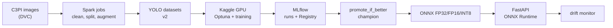
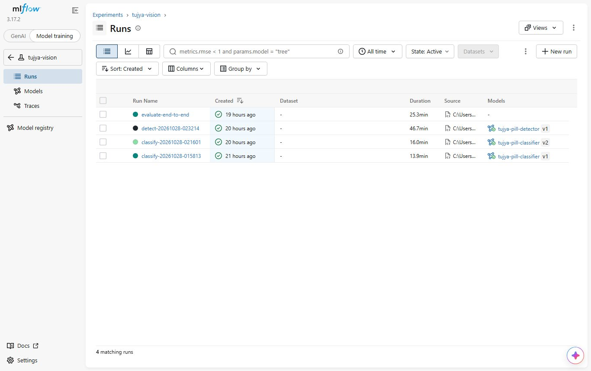
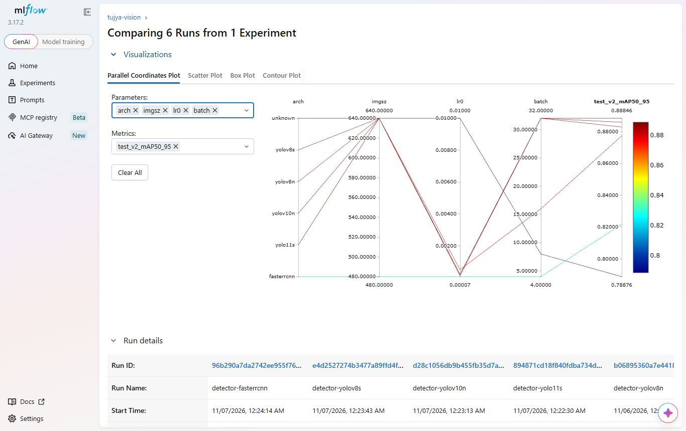
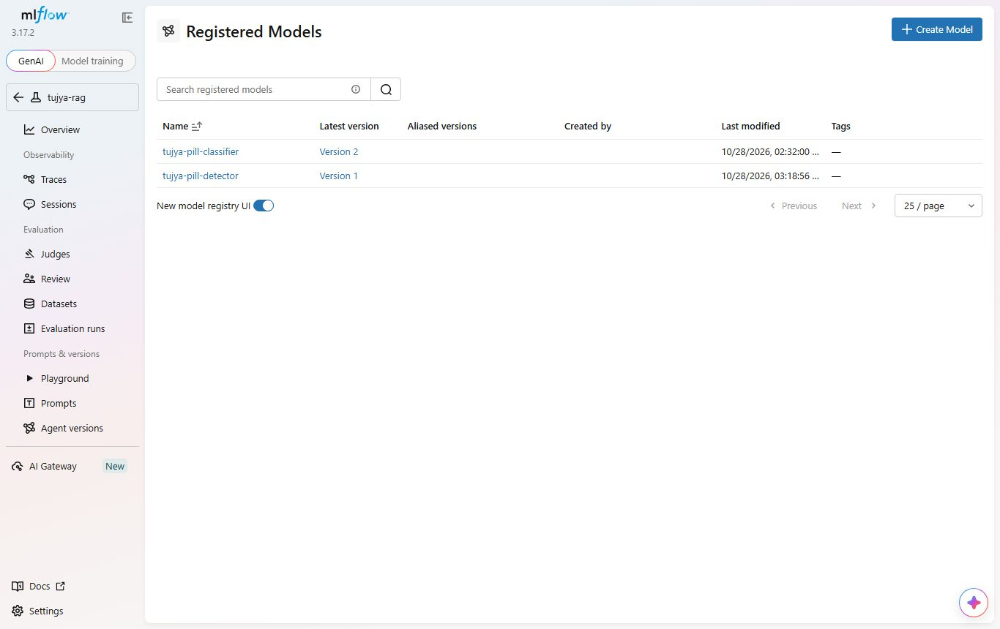
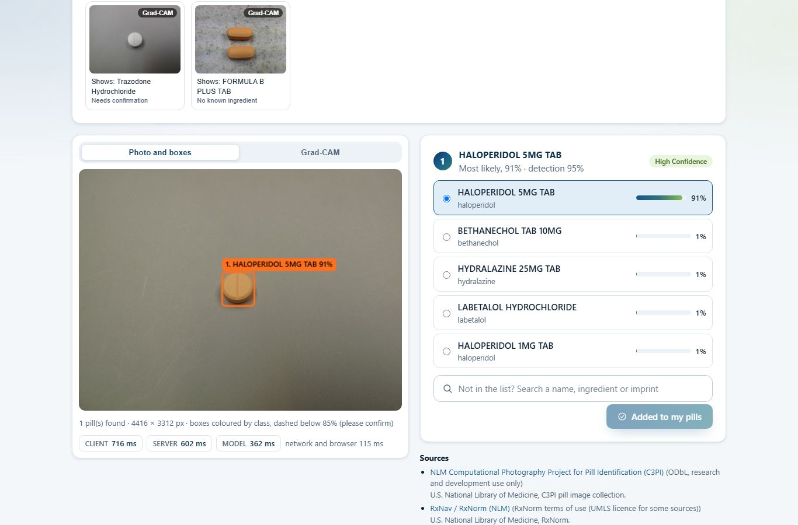
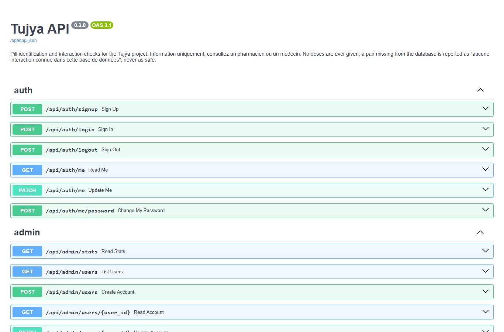
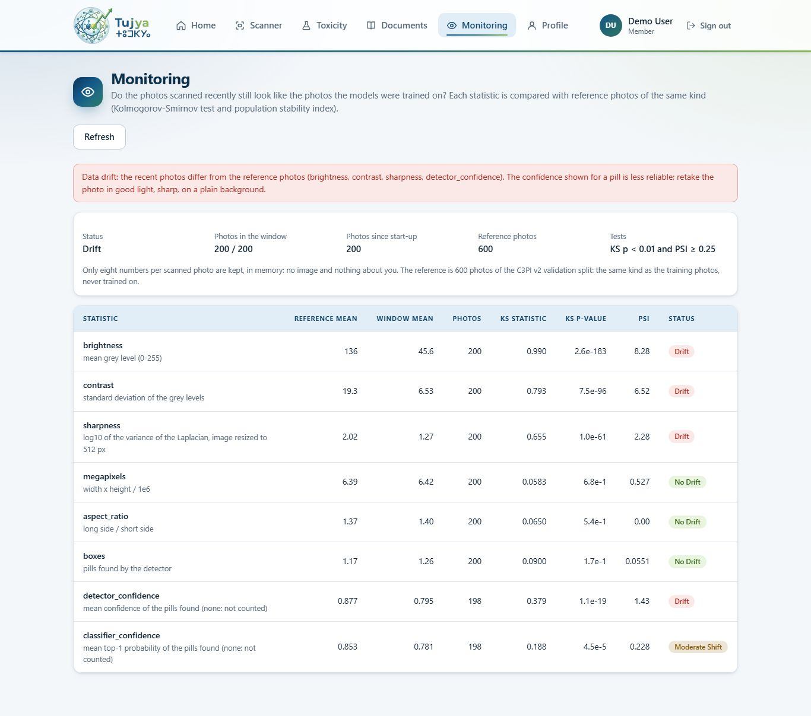
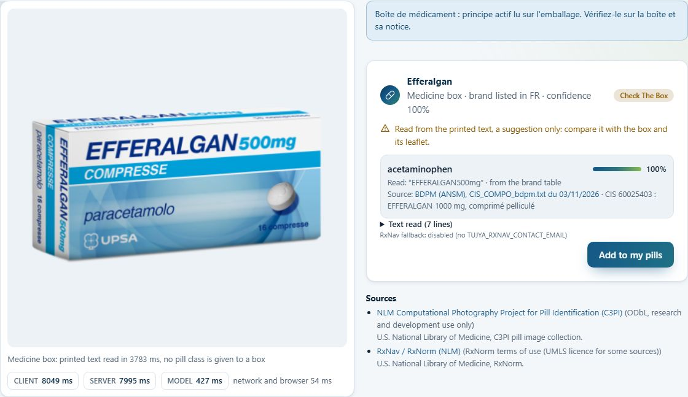

# Module 1: vision and MLOps

Identify pills on a photo: a detector finds every pill, a classifier names each one among 380
C3PI classes. The steps below go from raw images to the served API, in order. Results:
[results.md](results.md). Commands run from the repository root; training ones use the training
venv (`.venv-train`) and the MLflow server (`docker compose up -d mlflow`).

## 1. Data

| | |
|---|---|
| Code | [src/data/download.py](../../src/data/download.py), [src/data/spark/](../../src/data/spark/), [src/data/autolabel.py](../../src/data/autolabel.py), [src/data/prepare/](../../src/data/prepare/) |
| Command | `python -m src.data.download metadata` then `index`, `select`, `download`; `dvc repro spark_index spark_quality spark_split spark_augment`; `dvc repro prepare_detect_v2 prepare_classify_v2` |
| Result | before/after table, cleaning and leakage check in [data.md](../data.md); MLflow experiment `tujya-data` |

C3PI v2: 380 classes, 16,789 images, split by shooting session with 0 leakage. Boxes come from
classical computer vision, since C3PI has none.

## 2. Training on Kaggle with Optuna

| | |
|---|---|
| Code | [src/models/detection/runner.py](../../src/models/detection/runner.py), [src/models/classification/runner.py](../../src/models/classification/runner.py), search spaces in [config/hpo/](../../config/hpo/), notebooks in [notebooks/module1/kaggle/](../../notebooks/module1/kaggle/) |
| Command | `python -m src.models.detection.package_kaggle` (private Kaggle dataset); `python -m src.models.detection.notebook <arch>` (notebook generator); run the notebook on Kaggle (GPU); same with `classification` |
| Result | one export folder per model (`run.json`, weights, ONNX, trials) |

Each notebook clones its experiment branch (`experiment/detector-<arch>`,
`experiment/classifier-<arch>`), runs an Optuna study on the validation split, retrains the best
trial, scores it on the test splits and exports ONNX. Locally, `TUJYA_SMOKE=1` runs the same
notebook on a tiny subset.

## 3. Experiment tracking with MLflow

| | |
|---|---|
| Code | [src/models/detection/import_kaggle.py](../../src/models/detection/import_kaggle.py), [src/models/classification/import_kaggle.py](../../src/models/classification/import_kaggle.py), [src/utils/mlflow_utils.py](../../src/utils/mlflow_utils.py) |
| Command | `python -m src.models.detection.import_kaggle --no-latency <exports.zip>` (same for `classification`) |
| Result | http://localhost:5000, experiment `tujya-vision`: one parent run per model, one child run per Optuna trial |

Every run is tagged with `git_commit`, `dvc_rev`, `dataset` and `seed`, and stores
`requirements.txt`, `dvc.lock` and `params.yaml`, so it can be traced to its code and data.

## 4. Comparison

| | |
|---|---|
| Code | [src/models/detection/compare_latency.py](../../src/models/detection/compare_latency.py), [src/models/detection/compare.py](../../src/models/detection/compare.py), [src/models/classification/compare.py](../../src/models/classification/compare.py), [src/models/detection/metrics.py](../../src/models/detection/metrics.py) |
| Command | `python -m src.models.detection.compare_latency` (and `--task classify`); `python -m src.models.detection.compare`; `python -m src.models.classification.compare` |
| Result | tables of [results.md](results.md) (rewritten between their markers); MLflow compare view |

All models are scored by the same metric code on the same comparison split, and timed
together on the same CPU in interleaved rounds.

## 5. Champion selection

| | |
|---|---|
| Code | [src/models/registry.py](../../src/models/registry.py) (`promote_if_better`), [src/models/classification/evaluate_champion.py](../../src/models/classification/evaluate_champion.py) |
| Command | called by `import_kaggle`; the v1 champions are re-scored with `python -m src.models.detection.evaluate_champion` and `python -m src.models.classification.evaluate_champion` |
| Result | Model Registry `tujya-pill-detector` (YOLO11s v9) and `tujya-pill-classifier` (EfficientNetV2-S v8), aliases `champion` / `challenger` |

## 6. ONNX export and quantization

| | |
|---|---|
| Code | [src/models/export_onnx.py](../../src/models/export_onnx.py), [src/models/quantize.py](../../src/models/quantize.py), [src/models/optimize.py](../../src/models/optimize.py) |
| Command | `python -m src.models.optimize` (FP16, INT8 static and dynamic, alias `served`); `python -m src.models.registry publish` (copies the served models into `models/`) |
| Result | variants table of [results.md](results.md); `models/models.json` lists the served versions and their SHA-256 |

ONNX outputs are checked against PyTorch before registration. FP32 stays served: no variant
is both accurate enough and at least 5 % faster.

## 7. API

| | |
|---|---|
| Code | [backend/app/routers/vision.py](../../backend/app/routers/vision.py), [backend/app/inference.py](../../backend/app/inference.py), [backend/app/routers/scan.py](../../backend/app/routers/scan.py) |
| Command | `docker compose up -d --build`, then http://localhost:8000/docs |
| Result | `GET /health`, `GET /model/metadata`, `POST /predict`, `POST /predict/visualize` ([api.md](../api.md)); the web app at http://localhost:8080 |

The API runs ONNX Runtime with numpy and OpenCV only (no PyTorch). Below 0.85 of top-1 the app
asks the user to confirm the pill. Grad-CAM pictures of the demo gallery are precomputed offline
([src/models/gradcam_gallery.py](../../src/models/gradcam_gallery.py), DVC stage
`gradcam_gallery`).

## 8. Data drift monitoring

| | |
|---|---|
| Code | [backend/app/drift.py](../../backend/app/drift.py), [src/data/drift_reference.py](../../src/data/drift_reference.py), [src/data/drift_demo.py](../../src/data/drift_demo.py) |
| Command | `dvc repro drift_reference`; `PYTHONPATH="backend;." python -m src.data.drift_demo --mlflow` |
| Result | `GET /monitoring/drift`, the Monitoring page of the app, MLflow experiment `tujya-monitoring`; scenarios in [results.md](results.md#data-drift-monitor) |

Each scanned photo adds eight numbers to a sliding window (never the image); the window is
compared with the reference photos by a Kolmogorov-Smirnov test and the PSI.

## 9. Medicine boxes and OCR

| | |
|---|---|
| Code | [src/data/medicine_boxes.py](../../src/data/medicine_boxes.py), [src/models/ocr/](../../src/models/ocr/), [backend/app/boxes.py](../../backend/app/boxes.py) |
| Command | `python -m src.data.medicine_boxes download`, `dvc repro prepare_boxes`, `python -m src.models.ocr.evaluate --engine rapidocr` (and `easyocr`) |
| Result | OCR table of [results.md](results.md#medicine-boxes-ocr-engines); Registry `tujya-box-ocr` |

The pill models only know C3PI pills, so a photo of a box is read instead: RapidOCR text,
matched with the brand table and the INN names; a photo that is neither a pill nor a box is
refused.

## DVC pipeline

`dvc repro` rebuilds what changed; `dvc dag` shows the stages: `prepare`, `spark_*`,
`dataset_stats`, `prepare_detect_v2`, `prepare_classify_v2`, `prepare_boxes`, `train_detector`
and `train_classifier` (frozen: the recorded baseline), `export_onnx`, `evaluate`,
`gradcam_gallery`, `drift_reference`.
