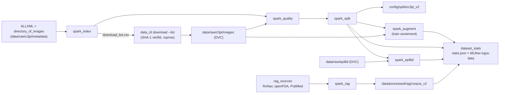

# Big Data avec PySpark : jeu de données C3PI v2 (data card)

Étape 1.4, demande du professeur : augmenter les données (plus de classes, plus d'images par
classe, augmentation d'images) et introduire le Big Data avec PySpark. Décisions : D88
(plan de données), D89 (split sans fuite), D90 (ePillID, corpus RAG v2).

## Sources et licences

| Source | Ce qui est pris | Licence | Rôle |
|---|---|---|---|
| NLM C3PI, https://data.lhncbc.nlm.nih.gov/public/Pills/ | index complet (110 fichiers ALLXML, `directory_of_images.txt`) ; photos « consumer » JPG, images de référence RxImage, images segmentées `MC_C3PI_REFERENCE_SEG_V1.6`, images du challenge `MC_CHALLENGE_V1.0` | ODbL, recherche et développement | entraînement, validation, test |
| ePillID (Usuyama et al., 2020), https://github.com/usuyama/ePillID-benchmark | `ePillID_data.zip` (release v1.0, 13 532 images 224 px, folds) | code MIT ; images dérivées de C3PI et Pillbox (NIH NLM) | benchmark de référence seulement |

Détail des licences et citations : [docs/data_pipeline/LICENSES.md](../data_pipeline/LICENSES.md).
Les images ne sont jamais dans git : `data/raw/c3pi/images.dvc`, `data/raw/epillid.dvc`.
Jamais téléchargé : `MC_COOKED_CALIBRATED_V1.2` (2,2 To), les CR2 (236 Go), les vidéos WMV.

## Avant / après

Chiffres de `data/processed/c3pi/bigdata/stats.json` (métriques DVC, `dvc metrics show`) et du
run MLflow `c3pi-v2-big-data` de l'expérience `tujya-data`.

| Mesure | Avant (v1, étapes 1.1 à 1.3) | Après (v2, étape 1.4) |
|---|---:|---:|
| Classes (produits NDC9 + partie) | 150 | **380** (les 150 de v1 comprises) |
| Critère de classe | les 150 premières, 7 appareils, budget 4 Go | au moins N = 20 photos « consumer » utilisables, 9 appareils |
| Photos « consumer » | 4 056 | **12 505** |
| Photos « consumer » par classe (min / moyenne / max) | 24 / 27,0 / 30 | 20 / **32,9** / 100 (classes de v1 : 40,7 en moyenne) |
| Autres images des classes (train seulement) | 150 RxImage | 374 RxImage, 3 040 segmentées, 870 du challenge |
| Images, hors augmentation | 4 206 | **16 789** |
| Images générées par augmentation (train) | 0 | **3 302** (322 classes complétées jusqu'à 40) |
| Train / val / test (photos « consumer ») | 2 856 / 600 / 600 | 9 148 / 1 580 / 1 777 (73 / 13 / 14 %) |
| Volume | 4,77 Go | **37,9 Go** dans les classes (+ 0,11 Go générés) ; 39,5 Go téléchargés au total |
| Fuites entre splits (groupes, fichiers, quasi-doublons) | contrôle par SHA-1 | **0 / 0 / 0** (contrôle bloquant du job `split`) |

Index complet lu par Spark : 133 458 fichiers (133 774 lignes XML, 316 doublons), 4 974
produits, 2,72 To ; les 133 458 chemins figurent aussi dans `directory_of_images.txt`.
Contrôle qualité des 20 330 fichiers téléchargés : 3 rejetés (2 copies d'un même fichier,
1 photo trop sombre), 10 paires de photos quasi identiques gardées ensemble, aucune photo
quasi identique entre deux produits ; liste dans `quality/rejected.csv`.

ePillID (13 532 images, 4 902 types) : 2 483 types sont dans l'archive C3PI, ses 3 728 photos
« consumer » toutes ; 242 des 380 classes de v2 ont des images ePillID, 197 des photos
« consumer » (986 images) : c'est le sous-ensemble de comparaison avec la littérature.

Corpus RAG traité par Spark (espace v1, D90) : 975 sections de notices lues, 969 gardées ;
1 570 résumés, 1 565 gardés (4 non anglais ou trop courts, 1 quasi-doublon MinHash) ;
8 642 chunks (3 997 documents) contre 8 661 pour le corpus v1 en pandas.

## Limites

- C3PI ne dit pas quel comprimé physique est photographié : le test mesure la
  généralisation à une nouvelle session de prise de vue (autre appareil, fond ou lumière),
  pas à un autre comprimé du même produit (D89). 347 des 380 classes n'ont qu'un paquet NDC11.
- Les images ePillID ne sont pas ajoutées à l'entraînement (recadrages d'images C3PI, D90).
- La collecte RAG des nouvelles classes (RxNav, openFDA, PubMed à 40 résumés par principe
  actif) est prête mais attend un `CONTACT_EMAIL` dans `.env` (D90).
- La réexécution de l'étape `prepare` (jeu v1) avec OpenCV 5.0 a déplacé de quelques pixels
  91 des 4 206 boîtes ; la version d'origine reste dans le cache DVC (dvc.lock de `v2.1.0-ci`).

## Chaîne de traitement



Chaque job est une étape DVC ([dvc.yaml](../../dvc.yaml), paramètres `bigdata` de
[params.yaml](../../params.yaml)) qui appelle `python -m src.data.spark.submit <job>` : le job
tourne dans le cluster Spark de `docker-compose.yml` (un master, un worker, profil `spark`,
[docs/infra.md](../infra.md#spark-big-data-étape-14)). `dvc dag` montre le graphe ;
`dvc repro` refait ce qui a changé ; `dvc params diff` montre un changement de paramètre.

| Job (code) | Ce qu'il fait en Spark | Sortie |
|---|---|---|
| `index` ([index_job.py](../../src/data/spark/index_job.py)) | lit les 110 XML (source XML native de Spark 4, schéma explicite, ISO-8859-1), joint `directory_of_images.txt`, déduplique les chemins, agrège par classe et par type, choisit les classes (au moins N photos « consumer », `bigdata.index.min_images`) et la liste à télécharger | `index/images` (Parquet partitionné par type), `class_stats`, `type_stats`, `classes`, `selection`, `download_list.csv` |
| `quality` ([quality_job.py](../../src/data/spark/quality_job.py)) | ouvre chaque image avec Pillow dans `mapInPandas` : octets, résolution, décodage complet, luminosité, contraste, netteté (variance du laplacien), hash perceptuel dHash 256 bits ; doublons par SHA-1 et quasi-doublons par jointure en bandes sur le hash (4 blocs : au plus 3 bits d'écart implique un bloc identique) | `metrics`, `near_duplicates`, `judged`, `rejected.csv` (chemin, classe, raison) |
| `split` ([split_job.py](../../src/data/spark/split_job.py)) | classes finales (N photos utilisables), groupes de prise de vue fusionnés le long des quasi-doublons (union-find), répartition par classe avec `applyInPandas`, contrôle de fuite | `split/images` (Parquet), [config/splits/c3pi_v2/](../../config/splits/c3pi_v2/) |
| `augment` ([augment_job.py](../../src/data/spark/augment_job.py)) | plan d'augmentation (Spark, graine par classe et indice), génération parallèle des images, uniquement à partir du train | `augmented/images/<classe>/`, `manifest` |
| `epillid` ([epillid_job.py](../../src/data/spark/epillid_job.py)) | NDC9 de chaque image ePillID, jointure avec l'archive C3PI et les classes v1 / v2 | `epillid/images`, `classes`, `summary.json` |
| `rag` ([rag_job.py](../../src/data/spark/rag_job.py)) | corpus RAG des deux espaces de collecte : nettoyage Spark SQL, déduplication (PMID, texte identique, MinHash LSH de `pyspark.ml`), découpage par partition avec les fonctions du corpus v1 | `data/processed/rag/corpus_v2/chunks` (Parquet partitionné par type) |
| `dataset_stats` ([log_stats.py](../../src/data/spark/log_stats.py)) | tableau avant / après, run MLflow | `stats.json` (métriques DVC), expérience MLflow `tujya-data` |

## Ce qui ne change pas

Le jeu v1 (150 classes, `config/pill_classes.csv`, `config/splits/selected_images.csv`, étape
DVC `prepare`) reste celui des modèles servis par l'API et de la baseline de l'étape 2.1 ;
ses images font partie du téléchargement v2 (même dossier `data/raw/c3pi/images`). Les modèles
seront entraînés sur v2 aux étapes 2.2 et 2.3 (augmentation en ligne RandAugment, MixUp et
CutMix dans le code d'entraînement). Le corpus RAG servi reste celui de l'étape `rag_corpus`
jusqu'à la phase 3.

## Reproduire

```bash
docker compose --profile spark up -d spark-master spark-worker      # UI : http://localhost:8090
python -m src.data.spark.submit index
python -m src.data.data_cli download --list data/processed/c3pi/bigdata/index/download_list.csv --workers 6
dvc add data/raw/c3pi/images
python -m src.data.spark.submit quality
python -m src.data.spark.submit split
python -m src.data.spark.submit augment
python -m src.data.spark.submit epillid
python -m src.data.spark.rag_sources ingredients     # .venv : RxNav, openFDA, PubMed (polis)
python -m src.data.spark.rag_sources labels
python -m src.data.spark.rag_sources pubmed
dvc add data/rag_v2
python -m src.data.spark.submit rag
.venv-train/Scripts/python -m src.data.spark.log_stats   # MLflow : docker compose up -d mlflow
# ou, une fois les données en place : dvc repro ; dvc dag ; dvc metrics show
```

Tests : `tests/data/spark/` (SparkSession `local[2]` sur de petits jeux factices : index,
qualité, split sans fuite, augmentation seulement sur le train, rééquilibrage, corpus RAG,
ePillID), lancés dans le conteneur Spark (commande dans [docs/infra.md](../infra.md)) et par
le job `spark` de la CI (Java 17).
