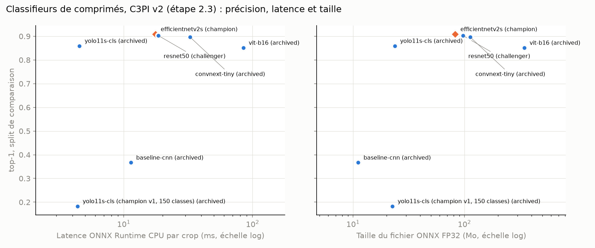
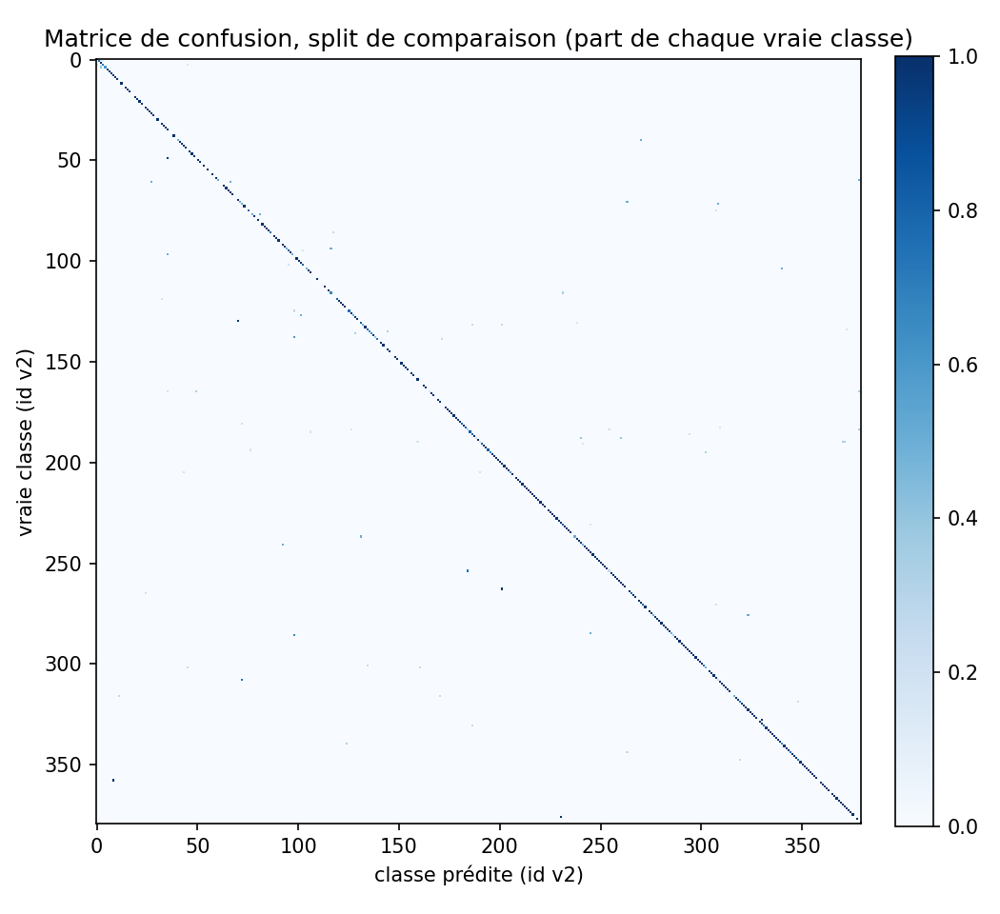
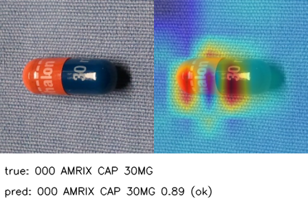
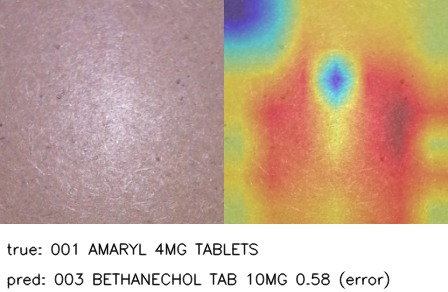

# Comparaison des classifieurs sur Kaggle (étape 2.3)

Remarques du professeur : « un seul choix de modèles testé », « pas de tests d'hyperparamètres
pour chaque modèle », « pas d'autres branches ». Cette étape compare six classifieurs de
comprimés au classifieur servi (champion YOLO11s-cls entraîné sur les 150 classes de v1, étape
2.1) : une baseline CNN maison entraînée sans poids préentraînés et cinq modèles préentraînés
sur ImageNet (axe CNN / ViT du guide : baseline contre modèles avancés), chacun avec sa
recherche d'hyperparamètres Optuna et sa branche git, sur le GPU gratuit de Kaggle. Décisions :
D99 (jeu de données et split de comparaison), D100 (notation du champion v1 et règle de
promotion), D101 (export ONNX et liste de classes), D102 (recette d'entraînement et recherche),
D103 (organisation et budget GPU) dans [docs/decisions.md](../decisions.md).

**État (12/11/2026) : runs Kaggle faits et importés.** Les six notebooks ont tourné sur un
Tesla T4 (12 à 16 essais Optuna chacun, 1,2 à 2,6 h), leurs exports sont dans MLflow (runs
parents et enfants, versions 8 à 13 de `tujya-pill-classifier`) et leurs poids dans DVC sur
chaque branche. Champion : **EfficientNetV2-S** (version 8, top-1 0,909 sur le split de
comparaison contre 0,183 pour le champion v1), challenger ResNet-50 (version 9) ; choix
expliqué dans D120 et dans la section « Analyse » plus bas. Il est servi par l'API depuis le
12/11 (FP32, la table de classes de l'API décrit les 380 classes, D119) : variantes FP16 / INT8
et vérification dans [optimisation_onnx.md](optimisation_onnx.md).

## Les modèles et leurs branches

| Branche | Modèle | Préentraînement | Paramètres | Blocs dégelables | Notebook |
|---|---|---|---:|---:|---|
| `experiment/classifier-baseline-cnn` | petit CNN maison (4 blocs de 2 convolutions 3x3, BN, ReLU, max pooling), la baseline | aucun (entraîné de zéro) | 1,3 M (largeur 32) | tout le réseau | `notebooks/kaggle/classifier_baseline-cnn.ipynb` |
| `experiment/classifier-resnet50` | ResNet-50 (torchvision) | ImageNet-1k (V2) | 24,3 M | 5 | `classifier_resnet50.ipynb` |
| `experiment/classifier-efficientnetv2s` | EfficientNetV2-S (torchvision) | ImageNet-1k | 20,7 M | 8 | `classifier_efficientnetv2s.ipynb` |
| `experiment/classifier-convnext-tiny` | ConvNeXt-Tiny (torchvision) | ImageNet-1k | 28,1 M | 8 | `classifier_convnext-tiny.ipynb` |
| `experiment/classifier-vit-b16` | ViT-B/16 (torchvision), 224 px | ImageNet-1k | 86,1 M | 13 | `classifier_vit-b16.ipynb` |
| `experiment/classifier-yolo11s-cls` | YOLO11s-cls (Ultralytics), l'architecture servie, réentraînée sur v2 | ImageNet-1k | 5,9 M | 10 | `classifier_yolo11s-cls.ipynb` |
| `main` (champion, étape 2.1) | YOLO11s-cls entraîné sur v1 (150 classes) | ImageNet-1k | 5,6 M | - | réévalué sur le même split |

Paramètres comptés avec la couche de sortie de 380 classes. Toutes les branches `experiment/`
partent de `feature/classifier-kaggle-tooling` (code commun) et n'ajoutent que leur configuration
Optuna `config/hpo/classifier_<archi>.yaml` et leur notebook. Seule la branche du champion sera
fusionnée dans `main` ; les autres restent poussées comme trace des expériences.

## Recette d'entraînement (D102)

Une seule boucle pour les six modèles
([torch_backend.py](../../src/models/classification/torch_backend.py), architectures dans
[architecture.py](../../src/models/architecture.py)) :

1. ***Transfer learning*** : `head_epochs` époques où seule la nouvelle couche de classification
   apprend (colonne vertébrale gelée, statistiques de batch norm conservées) ;
2. ***fine-tuning* sélectif** : les `unfreeze` derniers blocs sont dégelés et entraînés avec la
   tête à `lr x backbone_lr_mult` (AdamW, décroissance cosinus) ; la baseline, sans poids
   préentraînés, entraîne tout le réseau au même taux dès la première époque ;
3. **déséquilibre des classes** (10 à 80 crops de train par classe, médiane 39) : aucun
   traitement, poids de classe calculés sur le train, ou *focal loss* (gamma 2) ;
4. **augmentation du train seulement** : rotation quelconque (un comprimé est posé dans
   n'importe quel sens) et crop redimensionné aléatoire en une seule transformation affine,
   RandAugment, MixUp ou CutMix sur une part des lots, *label smoothing* ; pas de miroir (une
   empreinte inversée n'existe pas). La validation et le test ne reçoivent que le
   redimensionnement de l'API : aucune image augmentée ni de test n'influence le choix du modèle ;
5. arrêt précoce sur le top-1 de validation, limite de temps.

## Hyperparamètres recherchés

Optuna, échantillonneur TPE avec graine (`seed: 0`, 5 essais aléatoires d'abord), un run MLflow
enfant par essai. Chaque essai entraîne le modèle quelques époques sur une part stratifiée du
train (toutes les classes gardées) et il est noté sur la **validation** (`val_top1`) ; le
meilleur essai est réentraîné sur tout le train puis évalué **une seule fois** sur le test.

| Hyperparamètre | Modèles préentraînés | Baseline |
|---|---|---|
| `lr` (AdamW, échelle log) | 1e-4 à 3e-3 (ConvNeXt 1e-4 à 2e-3, ViT 5e-5 à 1e-3) | 3e-4 à 5e-3 |
| `backbone_lr_mult` (taux des blocs dégelés / taux de la tête) | 0,03 à 0,5 (log) | 1 (fixé) |
| `weight_decay` (log) | 1e-4 à 0,1 | 1e-4 à 0,1 |
| `unfreeze` (couches dégelées) | ResNet-50 1, 2, 3, 5 ; EfficientNetV2-S et ConvNeXt 2, 4, 6, 8 ; ViT 2, 4, 8, 13 ; YOLO11s-cls 3, 5, 7, 10 | tout |
| `imgsz` (taille d'image) | 192, 224 (ViT : 224 fixé) | 128, 160, 192 |
| `width`, `dropout` | - | 32 ou 48 canaux, 0 à 0,4 |
| `randaugment` (magnitude, 0 = sans) | 0, 3, 6, 9, 12 | idem |
| `mix_prob` (lots mélangés par MixUp / CutMix) | 0 à 0,6 | idem |
| `label_smoothing` | 0 à 0,15 | idem |
| `imbalance` | aucun, poids de classe, *focal loss* | idem |

Fixés : lot de 64, 4 processus de chargement, `head_epochs` 1 pendant la recherche et 2 au
réentraînement, RandAugment à 2 opérations, alpha 0,2 (MixUp) et 1,0 (CutMix).

## Données et équité de la comparaison (D99, D100)

- Jeu : **crops de C3PI v2** (étape DVC `prepare_classify_v2`,
  [prepare_classify_v2.py](../../src/data/prepare_classify_v2.py), sortie
  `data/processed/c3pi/datasets_v2/classify`) : le crop carré (marge de 20 %, 256 px) de chaque
  comprimé, celui que l'API donne au classifieur. Train : photos « consumer », images de
  référence, du challenge NLM, de studio segmentées et augmentation hors ligne des classes
  rares ; validation et test : photos « consumer » seulement.
- Split de comparaison `test_holdout.txt` : les crops de test dont la session de prise de vue ne
  contient aucune photo vue par le champion v1 en train ou en val (même règle que D93). Tous les
  modèles, champion compris, sont mesurés dessus : métriques `test_v2_*` (top-1, top-5, F1
  macro), métrique de promotion `test_v2_top1` (`params.yaml`, `compare.classifier`).
- Le champion v1 ne connaît que 150 classes : ses crops des 230 autres classes comptent comme
  erreurs dans `test_v2_*` ; `test_v2_v1c_*` note tous les modèles sur les crops des 150 classes
  v1, prédiction restreinte à ces classes (même espace d'étiquettes), et sert de garde-fou de
  promotion. Le test v2 complet est aussi rapporté (`test_v2_all_*`).
- Un seul code de mesure ([metrics.py](../../src/models/classification/metrics.py)), à partir
  des probabilités de chaque modèle, avec le prétraitement de l'API.

| Split | Crops | Classes | Dont 150 classes v1 |
|---|---:|---:|---:|
| train | 15 424 | 380 (10 à 80 par classe) | |
| val | 1 461 | | |
| test (complet, `test_v2_all_*`) | 1 713 | | |
| test de comparaison (`test_holdout.txt`, `test_v2_*`) | 1 131 | 323 | 275 (`test_v2_v1c_*`) |

582 crops de test viennent de sessions vues par le champion v1 et sont exclus du split de
comparaison. Chiffres : `data/processed/c3pi/datasets_v2/classify/summary.json` et
`classes.csv`.

Champion v1 réévalué sur ce split (`python -m src.models.classification.evaluate_champion`,
run `evaluate-classifier-v1-c3pi-v2`) : la référence que les candidats doivent battre.

| Modèle | top-1 comparaison | top-5 | F1 macro | top-1 classes v1 | top-5 classes v1 | top-1 test v2 complet |
|---|---:|---:|---:|---:|---:|---:|
| YOLO11s-cls entraîné sur v1 (150 classes, version 1, `champion`) | 0,1830 | 0,2246 | 0,1119 | 0,7527 | 0,9236 | 0,4466 |

Run `evaluate-classifier-v1-c3pi-v2` (`2b4fd382190a42a887d7fd4113509000`), scores ajoutés au run
de la version 1 (`6dd616a6fd6c4e46a0b73de2c9f7ba4c`), le 08/11/2026. Lecture :

- 207 crops justes sur les 1 131 du split de comparaison (0,1830), tous parmi les 275 crops de
  ses 150 classes : sur ces crops, prédiction restreinte à ses classes, il a 0,7527 de top-1
  (0,9236 de top-5), contre 0,937 sur le test v1. Le split v2 (nouvelles sessions de prise de
  vue, aucune vue à l'entraînement) est plus difficile, comme pour le détecteur (D93).
- Sur le test v2 complet il monte à 0,4466 : ce test contient 582 crops de sessions qu'il a vues
  en train ou en val, la fuite que le split de comparaison retire.
- Garde-fou de promotion (D100) : un candidat doit avoir `test_v2_v1c_top1` d'au moins
  0,7527 - 0,01 = 0,7427, et battre 0,1830 + 0,005 sur `test_v2_top1`.
- Latence ONNX CPU de cette mesure isolée (run de réévaluation seulement) : 4,2 ms par crop ; la
  latence comparée sera mesurée pour tous les classifieurs ensemble (section 6).

## Code (branche `feature/classifier-kaggle-tooling`)

| Fichier | Rôle |
|---|---|
| [src/data/prepare_classify_v2.py](../../src/data/prepare_classify_v2.py) | jeu de crops v2 et split de comparaison (étape DVC `prepare_classify_v2`) |
| [src/models/architecture.py](../../src/models/architecture.py) | les six architectures, blocs pour le *fine-tuning* sélectif, couche de Grad-CAM |
| [src/utils/gradcam.py](../../src/utils/gradcam.py) | Grad-CAM (cartes de convolution et jetons de ViT) |
| [src/models/classification/data.py](../../src/models/classification/data.py) | lecture du jeu, prétraitement de l'API, parts stratifiées, sous-ensembles |
| [src/models/classification/metrics.py](../../src/models/classification/metrics.py) | top-1, top-5, F1 macro, matrice de confusion, espace d'étiquettes restreint |
| [src/models/classification/hpo.py](../../src/models/classification/hpo.py) | espaces Optuna lus dans `config/hpo/classifier_<archi>.yaml` |
| [src/models/classification/torch_backend.py](../../src/models/classification/torch_backend.py) | entraînement, prédiction, export ONNX, images Grad-CAM |
| [src/models/classification/runner.py](../../src/models/classification/runner.py) | une expérience : recherche, réentraînement, test, export ONNX, dossier d'export |
| [src/models/classification/import_kaggle.py](../../src/models/classification/import_kaggle.py) | import d'un export dans MLflow : run parent + runs enfants, Registry, garde-fou, `promote_if_better` |
| [src/models/classification/evaluate_champion.py](../../src/models/classification/evaluate_champion.py) | réévaluation du champion v1 sur le split de comparaison |
| [src/models/classification/package_kaggle.py](../../src/models/classification/package_kaggle.py) | dossier et zip du dataset Kaggle privé (`runs/kaggle/`, ignoré par git) |
| [src/models/classification/notebook.py](../../src/models/classification/notebook.py) | génère les notebooks Kaggle (un modèle pour tous) |
| [src/models/classification/compare.py](../../src/models/classification/compare.py) | tableau et figure de comparaison depuis MLflow |
| [src/models/detection/compare_latency.py](../../src/models/detection/compare_latency.py) `--task classify` | latence ONNX CPU, taille et paramètres de tous les classifieurs, mesurés ensemble |
| [src/models/publish.py](../../src/models/publish.py) | refuse un classifieur dont la liste de classes ne correspond pas à la table de l'API (D101) |
| [tests/models/classification/](../../tests/models/classification/), [tests/models/test_architecture.py](../../tests/models/test_architecture.py), [tests/utils/test_gradcam.py](../../tests/utils/test_gradcam.py) | tests (store MLflow SQLite temporaire, famille de modèles factice ; ceux qui demandent PyTorch tournent dans le job CI `vision`, PyTorch CPU) |

Le format d'export (`run.json`, schéma 1) contient : code (`git_commit`, branche), données
(`MANIFEST.json` du dataset : hash DVC, `dvc_rev`), environnement (GPU, versions), espace et
résultats de chaque essai (paramètres, métriques de validation, historique par époque),
réentraînement (historique, métriques de validation et de test, latence) ; à côté :
`weights/best.pt`, `model/classifier.onnx` (avec la liste de classes dans ses métadonnées),
`classes.csv`, `confusion/` (matrice de confusion CSV et PNG, scores par classe, erreurs les plus
fréquentes), `gradcam/` (8 images : crop et carte Grad-CAM côte à côte, moitié justes, moitié
fausses), `trials.csv`, `config.yaml`, `requirements.txt`, `training/`, `optuna.db`.

## Mode d'emploi pas à pas

Rien de tout cela ne demande de mot de passe ni de jeton : les notebooks se lancent à la main
depuis le site Kaggle (un jeton API `kaggle.json`, si vous en installez un vous-même, permet
seulement d'automatiser les étapes 2 et 4).

### 1. Construire et empaqueter le jeu de données (PC)

```bash
# venv d'entraînement, depuis la racine (déjà fait sur la branche : dvc.lock à jour)
.venv-train/Scripts/python -m dvc repro prepare_classify_v2
.venv-train/Scripts/python -m src.models.classification.package_kaggle --owner <votre-nom-kaggle>
```

Sortie dans `runs/kaggle/` (ignoré par git) : le dossier `tujya-c3pi-classify-v2/` et
**`tujya-c3pi-classify-v2.zip` (0,28 Go, 18 598 crops de 256 px, 380 classes ; fait le 08/11,
`MANIFEST.json` : hash DVC `e14eb016f21452999a7abb4aa4fe88d5.dir`, `dvc_rev` `f78f79a`)**.

### 2. Créer le dataset Kaggle privé

Kaggle > **Datasets** > **New Dataset** : déposer `tujya-c3pi-classify-v2.zip`, titre
« Tujya C3PI v2 pill classification », identifiant `tujya-c3pi-classify-v2`, visibilité
**Private** (licence ODbL ; images du NLM pour la recherche, à ne pas redistribuer). Avec un
jeton installé par vos soins : `kaggle datasets create -p runs/kaggle/tujya-c3pi-classify-v2`
(privé par défaut).

### 3. Lancer chaque notebook (un par modèle)

Pour chaque modèle : Kaggle > **Code** > **New Notebook** > **File** > **Import Notebook** >
onglet GitHub, `melekbouabid/syRX`, branche `experiment/classifier-<archi>`, fichier
`notebooks/kaggle/classifier_<archi>.ipynb` (ou importer le fichier `.ipynb` téléchargé depuis
GitHub). Puis, dans **Settings** : **Accelerator** GPU T4 x1, **Internet** activé (clone de la
branche, `pip install` des versions figées, poids ImageNet). **Add Input** : votre dataset
`tujya-c3pi-classify-v2`. Enfin **Save Version** > **Save & Run All (Commit)** : le calcul
continue sans navigateur ouvert.

Ordre conseillé : d'abord **un seul** notebook court pour vérifier le parcours (YOLO11s-cls :
l'architecture servie, le gain de v2 se lit directement), puis les autres ; deux notebooks
peuvent tourner en même temps si le quota le permet (une session par notebook).

| Ordre | Notebook (branche `experiment/classifier-<archi>`) | GPU | Durée estimée | Limites de temps (recherche + réentraînement) | Import (PC) |
|---:|---|---|---:|---|---|
| 1 | `classifier_yolo11s-cls.ipynb` | T4 x1 | 2,3 h | 1,5 h + 0,9 h | `python -m src.models.classification.import_kaggle --no-latency classifier_yolo11s-cls_export.zip` |
| 2 | `classifier_baseline-cnn.ipynb` | T4 x1 | 2,75 h | 1,6 h + 1,3 h | `... import_kaggle --no-latency classifier_baseline-cnn_export.zip` |
| 3 | `classifier_resnet50.ipynb` | T4 x1 | 2,3 h | 1,5 h + 0,9 h | `... import_kaggle --no-latency classifier_resnet50_export.zip` |
| 4 | `classifier_convnext-tiny.ipynb` | T4 x1 | 2,5 h | 1,5 h + 1,1 h | `... import_kaggle --no-latency classifier_convnext-tiny_export.zip` |
| 5 | `classifier_efficientnetv2s.ipynb` | T4 x1 | 2,9 h | 1,6 h + 1,5 h | `... import_kaggle --no-latency classifier_efficientnetv2s_export.zip` |
| 6 | `classifier_vit-b16.ipynb` | T4 x1 | 2,8 h | 1,5 h + 1,4 h | `... import_kaggle --no-latency classifier_vit-b16_export.zip` |

L'import se fait en une seule commande à la fin (étape 6 : tous les exports d'un coup, du
meilleur au moins bon) ; la colonne donne la commande pour un export isolé.

#### Calcul du budget GPU (D103)

Débit d'entraînement mesuré sur le PC (RTX 2050, précision mixte, lot de 16 à 64 : baseline
648 crops/s à 128 px, YOLO11s-cls 224, ResNet-50 113, ConvNeXt-Tiny 69, EfficientNetV2-S 43,
ViT-B/16 43 à 224 px), multiplié par 2,5 pour un T4, et plafonné à environ 250 crops/s : le
chargement des crops (lecture JPEG, transformation affine, RandAugment) sur les 4 cœurs de Kaggle,
estimé à la moitié du débit mesuré sur le PC (615 crops/s sans RandAugment, 378 avec, 4
processus). Une époque complète (15 424 crops de train + validation) prend alors environ
1,1 min (baseline, ResNet-50, YOLO11s-cls), 1,6 min (ConvNeXt-Tiny), 2,2 min (EfficientNetV2-S)
et 2,5 min (ViT-B/16). Recherche = essais x époques x part du train ; environ 30 s de plus par
essai (construction du modèle, validation) et 15 min par notebook (installation, test, export
ONNX, parité, latence, Grad-CAM, zip).

| Notebook | Recherche (essais x époques x part) | Époques complètes | Recherche (min) | Réentraînement (au plus) | Réentraînement (min) | Total attendu | Borne (limites de temps) |
|---|---|---:|---:|---:|---:|---:|---:|
| baseline-cnn | 14 x 10 x 0,5 | 70 | 84 | 60 époques | 66 | 2,75 h | 3,3 h |
| resnet50 | 16 x 8 x 0,5 | 64 | 78 | 40 époques | 44 | 2,3 h | 2,75 h |
| yolo11s-cls | 16 x 8 x 0,5 | 64 | 78 | 40 époques | 44 | 2,3 h | 2,75 h |
| convnext-tiny | 14 x 8 x 0,4 | 45 | 79 | 35 époques | 56 | 2,5 h | 3,0 h |
| efficientnetv2s | 14 x 6 x 0,4 | 34 | 81 | 35 époques | 77 | 2,9 h | 3,5 h |
| vit-b16 | 12 x 6 x 0,4 | 29 | 78 | 30 époques | 75 | 2,8 h | 3,35 h |
| **Total** | | | | | | **15,5 h** | **18,7 h** |

La borne ajoute aux limites de temps (`timeout_hours` : plus de nouvel essai après ce temps,
`max_hours` : arrêt du réentraînement après l'époque qui le dépasse) un essai et une époque en
cours, et les 15 min fixes. Si le T4 ou le chargement est plus lent que prévu, la recherche fait
moins d'essais et le réentraînement moins d'époques, mais le total reste sous 20 h, dans le quota
gratuit (environ 30 h par semaine) et sous la limite de 12 h par session. L'arrêt précoce
(`patience` 6 à 12 époques) raccourcit souvent le réentraînement.

### 4. Récupérer les sorties

Dans la version sauvegardée de chaque notebook, onglet **Output** : télécharger
`classifier_<archi>_export.zip` (poids, ONNX, essais, matrice de confusion, Grad-CAM, `run.json`)
dans `runs/kaggle/`.

### 5. Réévaluer le champion actuel (déjà fait le 08/11, à refaire seulement si le champion change)

```bash
docker compose up -d mlflow
.venv-train/Scripts/python -m src.models.classification.evaluate_champion
```

Ajoute `test_v2_*` (dont `test_v2_top1` et `test_v2_v1c_top1`) au run de la version champion et
crée le run `evaluate-classifier-v1-c3pi-v2` (avec sa latence) : sans ces métriques l'import
refuse de promouvoir un candidat.

### 6. Importer les exports dans MLflow (PC)

```bash
# tous les exports en un seul appel : importés du meilleur au moins bon (D98, D100)
.venv-train/Scripts/python -m src.models.classification.import_kaggle --no-latency runs/kaggle/classifier_*_export.zip
# puis la latence de tous les classifieurs FP32, mesurés ensemble (D96, D98)
.venv-train/Scripts/python -m src.models.detection.compare_latency --task classify
```

Chaque import crée, dans l'expérience `tujya-vision`, le run parent `classifier-<archi>` (tags
`git_commit`, `git_branch`, `dvc_rev`, `dataset_md5`, `seed`, `label_space`, GPU ; paramètres
retenus ; métriques ; artefacts dont la matrice de confusion et les images Grad-CAM) et un run
enfant `trial-NNN` par essai Optuna ; puis il enregistre l'ONNX comme nouvelle version de
`tujya-pill-classifier` (tags `label_space=c3pi-v2`, `num_classes=380`) et appelle
`promote_if_better` sur `test_v2_top1` (gain minimal 0,005) avec le garde-fou de D100
(`test_v2_v1c_top1` au plus 0,01 sous celui du champion v1, sinon archivé) : alias `champion`,
`challenger` ou version archivée. Le résumé est écrit dans `models/compare/classifier_<archi>.json`.

Vérifications dans l'interface MLflow (http://127.0.0.1:5000) : expérience `tujya-vision`,
filtre `tags.stage = 'hpo' and tags.task = 'classify'` (runs enfants) puis **Compare** >
**Parallel Coordinates** (hyperparamètres contre `val_top1`) ; filtre
`tags.stage LIKE 'compare%' and tags.smoke = 'false' and tags.task = 'classify'` pour comparer
les modèles ; onglet **Models** pour les alias.

### 7. Poids dans DVC, tableau et figure (sur la branche de chaque modèle)

```bash
git switch experiment/classifier-<archi>
# dossier d'export dézippé, jamais dans git
.venv-train/Scripts/python -m dvc add data/models/classifiers/classifier-<archi>
git add data/models/classifiers/classifier-<archi>.dvc data/models/classifiers/.gitignore
git commit -m "exp(classifier): record the <archi> Kaggle run (test_v2_top1 0.xxxx)"
```

Puis, une fois tous les modèles importés (branche du champion) :
`python -m src.models.classification.compare` remplit le tableau ci-dessous et écrit la figure
`docs/module1/assets/classifieurs_comparaison.png` (top-1 contre latence CPU et contre taille du
fichier ONNX).

### 8. Fin de l'étape

1. Tests et lint ([docs/project_rules.md](../project_rules.md) ; `pytest` à la racine, dans
   `backend/` et `tools/`, `ruff`, `flake8`, `black`, `mypy`), `dvc status` propre.
2. Table de classes de l'API (D101) : le champion de l'étape a 380 sorties aux identifiants v2 ;
   `config/pill_classes.csv` (et les tables de médicaments chargées depuis lui) doit décrire les
   380 classes v2 avec ces identifiants avant la publication, sinon `python -m src.models.publish`
   refuse le modèle (`check_class_table`) au lieu de servir de mauvais noms de médicaments.
3. `python -m src.models.optimize --task classify` (variantes FP16 / INT8 du nouveau champion,
   alias `served`, étape 2.4), puis `python -m src.models.publish` copie le champion vers
   `models/` ; vérifier que l'API le sert (`/api/scan`, `/model/metadata`, `models.json`).
4. `git switch main && git merge --no-ff experiment/classifier-<champion>`.
5. Tags annotés : un `model/classifier-<archi>-v1.0.0` par modèle (note : métriques, run MLflow,
   version du Registry, statut champion / challenger / archivé), puis `v3.2.0-classifieurs`.
6. `git push origin main experiment/classifier-* v3.2.0-classifieurs model/classifier-*` et CI
   verte.

## Résultats

<!-- comparison:begin -->
| Modèle | top-1 val | top-1 test | top-5 test | F1 macro test | top-1 classes v1 | top-1 test v2 complet | Latence ONNX CPU (ms) | Taille ONNX (Mo) | Paramètres (M) | Version | Statut | Run MLflow |
|---|---:|---:|---:|---:|---:|---:|---:|---:|---:|---|---|---|
| efficientnetv2s | 0.9302 | 0.9089 | 0.9841 | 0.8790 | 0.9527 | 0.9136 | 17.6 | 82.5 | 20.6 | v8 | champion | `f1ed9edd` |
| resnet50 | 0.9138 | 0.9027 | 0.9673 | 0.8665 | 0.9418 | 0.9054 | 18.6 | 97.1 | 24.3 | v9 | challenger | `a53eb8fa` |
| convnext-tiny | 0.9288 | 0.8966 | 0.9814 | 0.8609 | 0.9491 | 0.9101 | 32.7 | 112.6 | 28.1 | v10 | archived | `8d2dac1f` |
| yolo11s-cls | 0.8925 | 0.8594 | 0.9646 | 0.8021 | 0.8982 | 0.8710 | 4.5 | 23.7 | 5.9 | v11 | archived | `9c8b058d` |
| vit-b16 | 0.8966 | 0.8515 | 0.9752 | 0.7888 | 0.8691 | 0.8517 | 84.9 | 344.6 | 86.1 | v12 | archived | `64a5682a` |
| baseline-cnn | 0.4346 | 0.3669 | 0.6101 | 0.2673 | 0.4618 | 0.3631 | 11.4 | 11.1 | 2.8 | v13 | archived | `4d756fb9` |
| yolo11s-cls (champion v1, 150 classes) |  | 0.1830 | 0.2246 | 0.1119 | 0.7527 | 0.4466 | 4.4 | 22.6 | 5.6 | v1 | archived | `2b4fd382` |
<!-- comparison:end -->

Le tableau est écrit par `python -m src.models.classification.compare` une fois les exports
importés (section 7) ; « top-1 test » est `test_v2_top1` (split de comparaison, métrique de
promotion), « top-1 classes v1 » `test_v2_v1c_top1` (garde-fou).



### Analyse

- **Transfer learning contre CNN maison.** Le CNN maison (2,8 M de paramètres, aucun poids
  préentraîné, même recette et même budget de recherche) plafonne à 0,367 de top-1 ; le moins bon
  modèle préentraîné sur ImageNet fait 0,852. Avec 40 images d'entraînement par classe en
  moyenne (15 424 crops pour 380 classes), apprendre les filtres de bas niveau à partir de zéro
  ne suffit pas : les poids ImageNet apportent l'essentiel.
- **ViT contre CNN.** ViT-B/16 a le plus de paramètres (86 M) mais finit dernier des modèles
  préentraînés en top-1 (0,852) et en F1 macro (0,789), et il est 4,8 fois plus lent que le
  champion sur CPU (84,9 ms par crop). Un transformeur n'a pas l'a priori de localité des
  convolutions : il lui faut plus d'images par classe pour en tirer parti. Son top-5 (0,975)
  reste proche des CNN : il range bien la bonne classe parmi les premières, mais tranche moins
  bien entre comprimés voisins.
- **Trois meilleurs à égalité statistique.** EfficientNetV2-S (0,9089), ResNet-50 (0,9027) et
  ConvNeXt-Tiny (0,8966) sont à moins de 1,3 point l'un de l'autre ; l'intervalle de confiance à
  95 % d'un top-1 de 0,9 sur 1 131 crops est d'environ +/- 1,7 point, et chaque modèle n'a été
  entraîné qu'une fois. La règle de promotion fixée avant les résultats (D100) désigne
  EfficientNetV2-S ; il a aussi le meilleur F1 macro, le meilleur score sur les classes v1 et
  la latence la plus basse des trois (17,6 ms). ConvNeXt-Tiny avait le meilleur top-1 de
  validation (0,929, à 0,001 du champion) : la validation sert à choisir les hyperparamètres,
  pas le modèle.
- **Compromis rapide.** YOLO11s-cls v2 (0,859 ; 4,5 ms ; 23,7 Mo) reste le choix si la latence
  devient la contrainte ; il fait déjà 4,7 fois mieux que la version v1 sur les 380 classes.
- **Nature des erreurs du champion.** 41 % de ses 103 erreurs (42) donnent une classe aux
  mêmes principes actifs : autre dosage du même médicament (gabapentine 600 / 800 mg,
  halopéridol 0,5 / 1 / 5 mg) ou autre fabricant du même générique (glipizide LP 10 mg,
  dicloxacilline). Le principe actif, qui seul sert à chercher les interactions, est donc juste
  pour 94,6 % des crops ; le dosage, lui, ne doit jamais être déduit de la photo (et l'application
  ne donne jamais de dose). Part des erreurs « même principe actif » : 38 % pour ResNet-50, 34 %
  pour ConvNeXt-Tiny, 28 % pour YOLO11s-cls, 32 % pour ViT-B/16, 8 % pour le CNN maison.
- **Grad-CAM.** Sur les crops bien classés, la carte se pose sur la gélule, son empreinte et la
  jonction des deux couleurs. Trois des quatre erreurs de l'export sont des crops sans comprimé
  (boîte automatique ratée, D99), où la carte s'étale sur le fond : une limite des boîtes
  automatiques plus que du classifieur ; la quatrième est un comprimé blanc rond sécable sans
  empreinte visible, pris pour un autre comprimé blanc (cas difficile même pour un humain).



| Bien classé | Erreur (crop vide) |
|---|---|
|  |  |

## Vérification locale (tests de fumée)

Avant Kaggle, chaque chaîne est vérifiée sur le PC (GPU RTX 2050, 4 Go) en mode « smoke » : le
notebook exécuté avec `TUJYA_SMOKE=1` (ou `python -m src.models.classification.runner --config
config/hpo/classifier_<archi>.yaml --smoke`) prend 96 / 32 / 32 crops (toutes les sorties des
380 classes gardées), 2 essais Optuna d'une époque, un réentraînement d'une époque, des images
plus petites (128 px, 64 px pour la baseline, 224 px pour ViT) et des lots de 16 ; l'export est
importé avec `python -m src.models.classification.import_kaggle <export> --smoke`. Ces runs
portent le tag `smoke=true` et un nom `smoke-...`, ne sont jamais enregistrés dans le Model
Registry et leurs métriques n'ont aucune valeur (une époque sur 96 crops pour 380 classes) : ils
prouvent seulement que le code, l'export et l'import fonctionnent.

Résultats du 08/11 (RTX 2050 4 Go, notebooks exécutés localement avec `TUJYA_SMOKE=1` depuis
leur branche, puis importés avec `--smoke` ; aucune version ajoutée au Registry, le champion reste
la version 1) :

| Notebook (commit) | Durée | Essais | Taille d'image | Run parent MLflow | Parité ONNX (accord top-1, 32 crops ; écart max) | ONNX (Mo) | Paramètres |
|---|---:|---:|---:|---|---|---:|---:|
| `classifier_baseline-cnn.ipynb` (`ea8eea2`) | 1,4 min | 2 (terminés) | 64 | `smoke-classifier-baseline-cnn` (`57877fff`) | 100 % ; 9e-8 | 5,1 | 1,27 M |
| `classifier_resnet50.ipynb` (`9d92a03`) | 2,0 min | 2 | 128 | `smoke-classifier-resnet50` (`df44640c`) | 100 % ; 2e-5 | 97,1 | 24,3 M |
| `classifier_efficientnetv2s.ipynb` (`79129dc`) | 2,1 min | 2 | 128 | `smoke-classifier-efficientnetv2s` (`fef94554`) | 100 % ; 2e-5 | 82,5 | 20,7 M |
| `classifier_convnext-tiny.ipynb` (`6f66fb4`) | 2,3 min | 2 | 128 | `smoke-classifier-convnext-tiny` (`ad1ae3d5`) | 100 % ; 2e-6 | 112,6 | 28,1 M |
| `classifier_vit-b16.ipynb` (`a0746c3`) | 5,2 min | 2 | 224 | `smoke-classifier-vit-b16` (`01127287`) | 100 % ; 2e-8 | 344,6 | 86,1 M |
| `classifier_yolo11s-cls.ipynb` (`c4d6ede`) | 1,6 min | 2 | 128 | `smoke-classifier-yolo11s-cls` (`a7892f7f`) | 100 % ; 4e-5 | 23,7 | 5,9 M |

Durée : exécution complète du notebook (téléchargement des poids ImageNet compris pour le
premier passage). Ce qu'ils vérifient : lecture du jeu, recherche Optuna (runs enfants),
phase « tête seule » dans les essais puis *fine-tuning* sélectif au réentraînement, évaluation
sur les deux splits de test et sur les classes v1, export ONNX (parité PyTorch / ONNX Runtime),
latence dans un processus séparé, matrice de confusion, 8 images Grad-CAM, zip, import MLflow
avec les tags de provenance. Les six ONNX ont aussi été chargés par le scanner de l'API
(`backend/app/inference.py`, avec le détecteur servi) sans modification : entrée carrée lue dans
le graphe, 380 sorties, top-5 et probabilités sur une photo de test ; `python -m
src.models.publish` les refuse tant que la table de classes de l'API est celle de v1 (D101).
Cinq de ces runs portent `git_dirty` : une modification de
`evaluate_champion.py` (sans lien avec l'entraînement) était en cours pendant les tests et a été
commitée ensuite.

## Limites

- Un seul entraînement par modèle (une graine) : un écart de moins d'un point de top-1 sur
  1 131 crops n'est pas significatif.
- Le split de comparaison n'a aucun crop pour 57 classes (sessions toutes vues par v1 ou trop
  peu de photos) ; le test v2 complet est rapporté à côté (il contient le split).
- Les boîtes des crops sont produites automatiquement (pas d'annotation manuelle), comme pour v1 :
  un crop mal centré est compté comme une erreur pour tous les modèles.
- Les durées sur T4 sont des estimations (débit du PC multiplié par 2,5, chargement plafonné) ;
  les limites de temps de chaque configuration bornent le coût réel (D103).
- Grad-CAM n'est pas servi par l'API (il demande PyTorch et les gradients, D97) : il est dans
  chaque export et dans MLflow (artefacts `gradcam/`).
