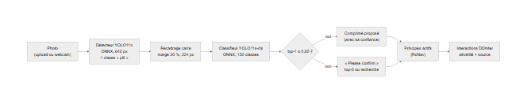

# Chaîne de vision : détecter, puis identifier

Axe vision du module 1. Deux modèles, tous deux des YOLO11 d'Ultralytics affinés à partir
de poids COCO / ImageNet (*transfer learning*), suivis dans MLflow, exportés en ONNX.

```
photo ──> détecteur (YOLO11n, 1 classe « pill ») ──> une boîte par comprimé
             └─ recadrage de chaque boîte (carré, marge de 20 %, 224 px)
                   └─> identifieur (YOLO11s-cls, 150 classes) ──> top-5 + confiance
                          └─> classe -> principes actifs (RxNav) -> interactions DDInter
```



Code : [`src/data/`](../../src/data/) (`autolabel.py`, `prepare.py`) et
[`src/models/`](../../src/models/) (`train.py`), avec son propre venv `.venv-train`
([`src/models/requirements-train.txt`](../../src/models/requirements-train.txt)). Données :
[docs/module1/dataset_c3pi.md](dataset_c3pi.md).

## D'où viennent les boîtes (décision D38)

C3PI ne fournit aucune boîte ([docs/module1/dataset_c3pi.md](dataset_c3pi.md)). Trois options ont été
étudiées :

1. Des annotations existantes : aucune dans C3PI ; ePillID fournit des recadrages, pas des
   boîtes sur les photos.
2. Un jeu public de détection de comprimés (Roboflow et similaires) : licences floues ou
   propres à chaque contributeur, images différentes des photos C3PI, et une seconde source
   de données à documenter. Non retenu.
3. **Étiquetage automatique des photos « consumer »** (retenu) : chaque photo montre un ou
   deux comprimés sur un fond assez uni, la vision classique les trouve donc de façon assez
   fiable, et les photos douteuses peuvent être repérées et écartées.

[`autolabel.py`](../../src/data/autolabel.py) : surface de fond quadratique
robuste en Lab (absorbe le vignettage), distance de couleur avec les ombres atténuées, seuil
borné, régions connexes ne touchant pas le bord, pièces de monnaie (référence de taille de
C3PI) rejetées par leur texture, régions en croissant (une ombre à côté d'un comprimé clair)
affinées par GrabCut, petites taches claires abandonnées. Chaque photo reçoit des drapeaux ;
une photo avec un drapeau douteux est exclue des **deux** jeux de données.

Le détecteur apprend donc sur des étiquettes produites par la machine ; il est évalué contre
le même type d'étiquettes sur les photos de test. Les scènes à plusieurs comprimés sont
apprises sur les photos à deux comprimés (recto et verso) et grâce à l'augmentation
« mosaïque » d'Ultralytics, qui assemble quatre photos.

## Jeux de données (étape DVC `prepare`)

`python -m src.data.prepare` (ou `dvc repro prepare`) écrit, à partir de
`config/splits/selected_images.csv` :

- `data/processed/c3pi/labels/autolabel.csv` : par image, boîtes, drapeaux, ok
- `data/processed/c3pi/datasets/detect/` : format YOLO, grand côté 640 px, photos propres seulement
- `data/processed/c3pi/datasets/classify/<split>/<class_id:03d>/` : recadrages carrés de 224 px, deux
  au plus par photo (recto et verso), plus des recadrages des images de référence RxNav
  (entraînement seulement)

Une photo et tous ses recadrages restent dans le split de `selected_images.csv`.

## Entraînement, évaluation, export, registre

```bash
docker compose up -d                                   # MLflow sur http://localhost:5000
# depuis la racine du dépôt, venv d'entraînement (.venv-train) actif
python -m src.models.train classify --epochs 20
python -m src.models.train detect --epochs 10 --imgsz 640
```

Chaque exécution est journalisée dans l'expérience MLflow `tujya-vision` : paramètres,
étiquettes du matériel, nombres d'images, métriques par époque (depuis le `results.csv`
d'Ultralytics), métriques de test, graphiques, `best.pt` ; puis elle exporte `best.onnx`,
vérifie ONNX Runtime contre PyTorch sur des images de test, et enregistre le modèle ONNX comme
nouvelle version de `tujya-pill-classifier` ou de `tujya-pill-detector`.

## Résultat de l'étiquetage automatique (2026-10-28)

| | Photos |
|---|---:|
| Photos « consumer » | 4 056 |
| Propres (utilisées) | 3 306 (81,5 %) |
| Drapeau `irregular_region` (ombre ou demi-comprimé, GrabCut n'a pas pu corriger) | 462 |
| Drapeau `no_region` (comprimé trop proche de la couleur du fond, granit texturé) | 346 |
| Autres drapeaux douteux (allongé, trop de régions, trop grand) | 73 |
| Corrigées par GrabCut (`refined`, gardées) | 311 |
| Pièce présente et ignorée (gardées) | 111 |

Boîtes par photo propre : 1 (2 862), 2 (775), 3 (43), 4 (30).

**Contrôle à l'œil** d'une planche aléatoire de 48 photos
(`python -m src.data.prepare --sheet`) : 40 ont passé les filtres, dont 36 avec toutes
leurs boîtes justes (environ 90 %). Les erreurs sont surtout un rectangle pâle de lumière
inégale près du bord inférieur d'un papier beige, et une fois un second comprimé manqué. Les
photos douteuses étaient bien signalées. Améliorer les étiquettes (vérification à la main du
split de test, ou second passage d'étiquetage avec le détecteur entraîné) fait partie des
étapes suivantes.

Jeux : identification 2 962 recadrages d'entraînement / 562 de validation / 589 de test
(150 / 150 / 148 classes : deux classes n'ont aucune photo de test propre) ; détection
2 345 / 478 / 483 photos.

## Résultats

### Identification (classifieur)

| Exécution | Modèle | Matériel | Époques | Top-1 test | Top-5 test | ONNX contre PyTorch |
|---|---|---|---:|---:|---:|---|
| essai (vérification de la chaîne) | YOLO11n-cls | CPU | 3 | 19,4 % | 36,0 % | top-1 identique à 100 %, écart max de probabilité 1,5e-7 |
| principale | YOLO11s-cls | RTX 2050 | 40 | **93,5 %** | **98,1 %** | top-1 identique à 100 %, écart max de probabilité 1,6e-6 |

Exécution principale : 14 min d'entraînement, validation top-1 92,2 % / top-5 97,9 % à la
dernière époque, run MLflow `7d2ce0ff7c53401aa42d2ef89c3aa794`, enregistrée comme
`tujya-pill-classifier` version 2 (la version 1 est l'essai). Test = 589 recadrages de photos
jamais vues à l'entraînement.

### Détection

| Exécution | Modèle | Matériel | Époques | mAP50 test | mAP50-95 test | Précision | Rappel | ONNX contre PyTorch |
|---|---|---|---:|---:|---:|---:|---:|---|
| principale | YOLO11n, 640 px, batch 8 | RTX 2050 | 30 | **0,972** | **0,861** | 0,957 | 0,936 | même nombre de boîtes sur 100 % de 50 photos de test, IoU moyen 0,976 |

Run MLflow `5c6db57a144b483aaf37b94e74f5e2cb`, enregistré comme `tujya-pill-detector`
version 1. Test = 483 photos de test propres, notées contre les boîtes automatiques (dont la
précision propre est d'environ 90 %, voir plus haut) : ces chiffres mesurent donc l'accord
avec l'étiqueteur automatique.

### De bout en bout (ce que ferait l'application)

`python -m src.models.evaluate` sur **les 600 photos « consumer » du split de test**
(y compris les 117 que l'étiqueteur a rejetées), avec les deux exports **ONNX** : le
détecteur tourne sur la photo entière, la boîte la plus sûre est recadrée et classée.

| Photos | Comprimé détecté | Top-1 | Top-5 |
|---:|---:|---:|---:|
| 600 | 98,5 % | **89,2 %** | **95,8 %** |

Run MLflow `9bfa9d81a606472892fbf67efe7036e1` (`evaluate-end-to-end`). Plus lent que
nécessaire (25 min sur CPU) parce qu'Ultralytics a installé `onnxruntime-gpu` à la volée
pendant cette exécution ; l'installation automatique est désactivée depuis dans
`src/models/__init__.py` (D42).

### À propos de ces scores

Ce que signifient ces chiffres : l'entraînement et le test contiennent **des photos
différentes des mêmes comprimés physiques** (C3PI a photographié chaque comprimé de
nombreuses fois, avec plusieurs appareils, éclairages et fonds), et les recadrages de test
viennent des boîtes automatiques, pas du détecteur. Le score de bout en bout (boîtes du
détecteur -> classifieur) et un test sur des photos d'autres exemplaires des comprimés
seraient plus bas ; ce sont deux étapes suivantes.

## Comparaison avec ePillID

ePillID (Usuyama et al., 2020) est construit sur les mêmes images C3PI mais résout un
problème plus difficile : des milliers de classes d'apparence (produit et face du comprimé),
peu d'exemples par classe, recherche des photos « consumer » parmi des images de référence.
L'identifieur de Tujya est un classifieur à ensemble fermé sur 150 produits ayant chacun plus
de 20 photos, entraîné et testé sur des photos « consumer » des mêmes produits. Les chiffres ne
sont donc **pas comparables** à ceux d'ePillID ; une comparaison honnête demanderait de
réentraîner sur le split et les métriques d'ePillID (MAP, GAP, top-k sur le jeu réservé),
étape ultérieure.

## Service : la chaîne propre à l'API et le seuil de confirmation

`POST /api/scan` ([docs/api.md](../api.md)) n'utilise pas Ultralytics :
[`backend/app/inference.py`](../../backend/app/inference.py) réimplémente le letterbox, la NMS et le
recadrage à 20 % de marge avec numpy et OpenCV, et fait tourner les deux fichiers ONNX avec
ONNX Runtime (D45). Vérifications :

- sur 40 photos de test, contre le prédicteur ONNX d'Ultralytics : même nombre de boîtes sur
  40/40, IoU moyen de la boîte principale 0,9999, même classe top-1 sur 39/39 (une photo sans
  boîte) ;
- sur les 600 photos de test
  (`python -m src.models.evaluate_scan --split test`) : comprimé trouvé
  98,5 %, top-1 **89,3 %**, top-5 **95,8 %**, comme l'évaluation de bout en bout ci-dessus.

### Seuil de confirmation

L'application demande à l'utilisateur de confirmer un comprimé quand sa probabilité top-1 est
sous un seuil (`needs_confirmation`). Choisi sur les photos de **validation** (600, jamais
utilisées pour l'entraînement), avec
`python -m src.models.evaluate_scan --split val` : règle = le plus petit
seuil pour lequel au plus 1 % de toutes les photos serait accepté avec un mauvais comprimé.

| Seuil | Acceptées sans confirmation | Top-1 parmi les acceptées | Fausses et acceptées (part de toutes les photos) |
|---:|---:|---:|---:|
| 0,5 | 87,2 % | 91,2 % | 7,7 % |
| 0,7 | 77,7 % | 95,3 % | 3,7 % |
| 0,8 | 71,7 % | 97,7 % | 1,7 % |
| **0,85** | **67,2 %** | **98,5 %** | **1,0 %** |
| 0,9 | 60,3 % | 98,9 % | 0,7 % |
| 0,95 | 48,5 % | 99,7 % | 0,2 % |

Validation au total : comprimé trouvé 98,5 %, top-1 84,2 %, top-5 94,8 %. **Seuil 0,85**
(D47). Sur les photos de test à 0,85 : 70,5 % acceptées, dont 99,3 % justes, et 0,5 % de
toutes les photos acceptées avec un mauvais comprimé. Un comprimé confirmé ou corrigé est
toujours affiché avec sa probabilité, et l'identification reste une suggestion.

Vitesse du service : les threads en attente active d'ONNX Runtime rendaient OpenCV (et tout
le processus) environ 30 fois plus lents sur le CPU partagé du portable ; l'attente active est
désactivée dans les sessions (D49), soit environ 50 à 220 ms par photo pour le décodage, la
détection et l'identification.
