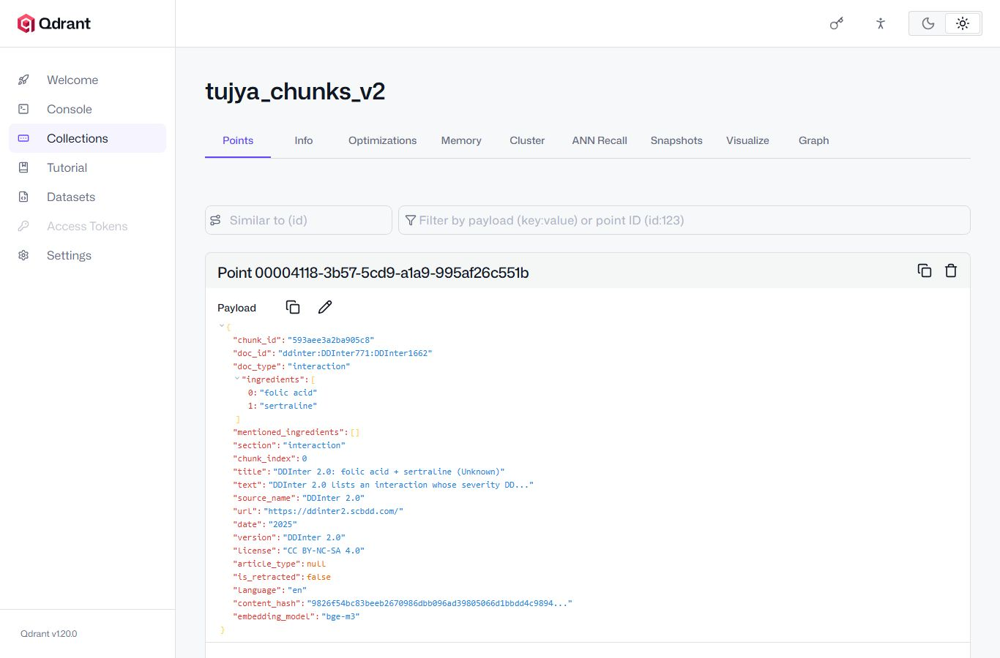
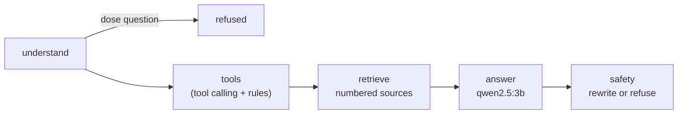
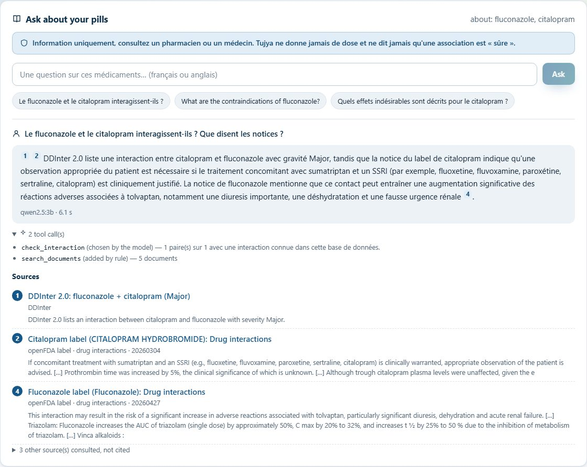
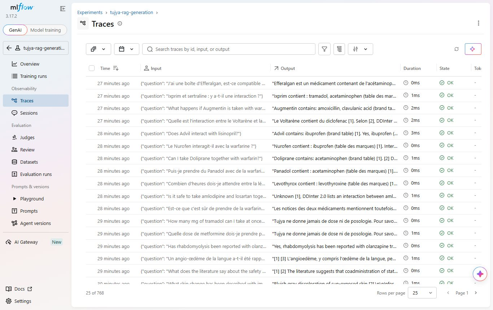
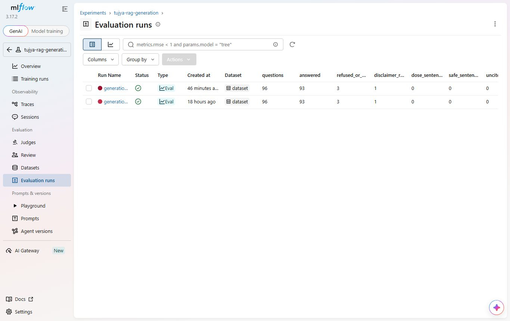

# Module 2: AI engineering

A LangGraph agent answers questions about the scanned pills from a cited RAG corpus (openFDA
labels, PubMed abstracts, DDInter interactions), with safety rules enforced in code.
[src/rag/](../../src/rag/) has one file per step of the pipeline below. Results:
[results.md](results.md). Commands run from the repository root in the project venv (`.venv`)
with the stack running (`docker compose up -d`). Executed notebooks of each step:
[notebooks/](../../notebooks/README.md).

```text
Sources: openFDA drug labels (JSON) · PubMed abstracts (XML) · DDInter interactions (CSV)
   |
[step1 — Extractor]   connectors -> clean text per document          src/rag/extractor.py
[step2 — Metadata]    ingredient · brand · source · section ·        src/rag/metadata.py
                       language · year · url
[step3 — Chunker]     ~1500-char chunks with overlap,                src/rag/chunking.py
                       label sections kept whole
[step4 — Embedder]    BAAI/bge-m3 via Ollama (1024-dim) + BM25        src/rag/embedder.py
[step5 — Qdrant]      tujya_chunks_v2, dense HNSW cosine + sparse,    src/rag/vector_store.py
                       add / update / delete a document  <---------+
User question -> drug-name detection (brand -> ingredient)          |  src/rag/query_rewriting.py
   + query rewriting -> hybrid search (dense + BM25, RRF), top-k ---+  src/rag/retrieval.py
   (reranker measured, not served)                                     src/rag/reranking.py
[step6 — LLM]         qwen2.5:3b via Ollama + prompt v1               src/rag/rag_chain.py
   -> safety check (no dose, no "safe", cited sentences only)          src/agent/safety.py
   -> Answer + citations + disclaimer
Around it: LangGraph agent (src/agent/graph.py), tools (src/agent/tools.py),
MCP server (src/agent/mcp_server.py) + client demo (src/agent/mcp_smoke.py)
Evaluation (src/evaluation/): retrieval metrics + Recall@k curve; generation EM/F1/ROUGE/BLEU/
semantic similarity + Ragas; judge check (Cohen's kappa); embedding fine-tuning vs baseline.
```

## Steps

| Step | File | Command | Where to see the result |
|---|---|---|---|
| 1 Extractor | [src/rag/extractor.py](../../src/rag/extractor.py), connectors in [src/data/sources/](../../src/data/sources/) | `python -m src.rag.extractor labels`, `pubmed`, `ddinter`, `interactions`; for the 380 classes `python -m src.data.spark.rag_sources labels`, `pubmed` | `data/external/rag_v1/interim`, `data/external/rag_v2/interim`, `data/processed/pharma` |
| 2 Metadata | [src/rag/metadata.py](../../src/rag/metadata.py) | `python -m src.rag.extractor ingredients` (RxNav) | `config/pill_classes.csv`, `data/processed/pharma/pill_ingredients.csv` |
| 3 Chunker | [src/rag/chunking.py](../../src/rag/chunking.py), Spark job [src/data/spark/rag_job.py](../../src/data/spark/rag_job.py) | `dvc repro spark_rag` | `data/processed/rag/corpus_v2`: 27,302 chunks |
| 4 Embedder | [src/rag/embedder.py](../../src/rag/embedder.py) | called by step 5 | the `dense` and `bm25` vectors of each Qdrant point |
| 5 Qdrant | [src/rag/vector_store.py](../../src/rag/vector_store.py) | `python -m src.rag.vector_store index` (the `rag-init` container at start-up); `add`, `update`, `delete`, `show` | http://localhost:6333/dashboard (below); the Documents page of the app |
| Query | [query_rewriting.py](../../src/rag/query_rewriting.py), [retrieval.py](../../src/rag/retrieval.py), [reranking.py](../../src/rag/reranking.py) | `python -m src.rag.retrieval "fluconazole warfarin" --ingredient warfarin --k 5` | the ranked chunks in the terminal; [results.md](results.md#retrieval-metrics-of-the-course) |
| 6 LLM | [src/rag/rag_chain.py](../../src/rag/rag_chain.py), prompts in [src/agent/prompts.py](../../src/agent/prompts.py) | `python -m src.agent.ask "Does warfarin interact with fluconazole?"` | the chat panel of the app; MLflow traces |

## 1. Extractor

Sources are collected by the polite pipeline of `src/data/sources` (official APIs, rate limits,
cache, manifest): openFDA label sections, PubMed abstracts found by ingredient queries, DDInter
interaction rows (each pair once, with a sentence that states its severity). Dosage sections
are never stored. The Spark job cleans and deduplicates the texts (exact and MinHash). Result:
13,660 documents of 175 ingredients ([data.md](../data.md#rag-corpus)).

## 2. Metadata

Each pill class gets its active ingredients from RxNav (NDC -> RxCUI -> base ingredients, or
the generic name as a fallback); DDInter names are matched to them through
`config/ingredient_aliases.csv`. Every chunk then carries `ingredients` (what it is about),
`mentioned_ingredients`, `doc_type`, `section`, `language`, `date` (label effective time or
publication year), `url`, `version`, `license`, and the brand in the label title. The brand
names typed by users are resolved to ingredients by the brand table (`lookup_brand`).

## 3. Chunker

Pieces of at most 1,500 characters cut on sentence ends, one sentence of overlap; a label
section shorter than that stays whole, an abstract is cut by paragraph, a DDInter pair is one
chunk. Other sizes are compared in [results.md](results.md#retrieval-configuration-grid)
([src/evaluation/chunking_variants.py](../../src/evaluation/chunking_variants.py)).

## 4. Embedder

Dense: BAAI/bge-m3 served by Ollama (`/api/embed`, 1,024 dimensions, unit-length vectors),
multilingual, so a French question finds English label text. Sparse: fastembed `Qdrant/bm25`,
with the IDF applied by Qdrant. The tests use offline fakes with the same interfaces.

## 5. Vector store in Qdrant

One point per chunk in `tujya_chunks_v2`: the named vectors `dense` (HNSW, cosine) and `bm25`
(sparse, IDF modifier), the metadata as payload with keyword indexes on the filtered fields.
Indexing is idempotent: a chunk is embedded again only when its content hash changes.

**Updating one document.** A document is one JSON object (`doc_id`, `doc_type`, `title`,
`text`, `source_name`, optional `section`, `url`, `date`, `version`, `license`, `language`,
`ingredients`). It is cut like the corpus; its chunk ids, and so its point ids, come from the
doc id, the section and the chunk index, so running a command again never creates duplicates.

```bash
python -m src.rag.vector_store sample --collection tujya_chunks_v2 --to tujya_test_updates --n 300
python -m src.rag.vector_store add    --document docs/module2/examples/document_v1.json --collection tujya_test_updates
python -m src.rag.vector_store update --document docs/module2/examples/document_v2.json --collection tujya_test_updates
python -m src.rag.vector_store show   --doc-id demo:demotabine --collection tujya_test_updates
python -m src.rag.vector_store delete --doc-id demo:demotabine --collection tujya_test_updates
python -m src.rag.vector_store drop   --collection tujya_test_updates
```

`update` embeds only the chunks whose text changed and deletes the chunks the new version no
longer has; `add` refuses a document already indexed, `update` one that is not. Writing to a
served collection needs `--allow-served`; a served collection is never dropped. The API sees
the change at its next question (the index metadata `indexed_at` changes). The demo of
[results.md](results.md#document-updates) ran on a trial copy of 300 points.

**What to show in Qdrant** (http://localhost:6333/dashboard):

1. *Collections*: `tujya_chunks_v2`, 27,302 points, vectors `dense` (1,024, Cosine) and sparse
   `bm25`; the collection info lists the payload indexes (`doc_type`, `ingredients`,
   `section`, `language`, `is_retracted`...).
2. *Points* of the collection: open a point to see its payload, the metadata of the chunk
   (`title`, `text`, `doc_type`, `ingredients`, `section`, `url`, `date`, `license`,
   `language`, `content_hash`, `embedding_model`); filter the points by a payload field.
3. *Console*, a filtered search on the metadata:

   ```http
   POST collections/tujya_chunks_v2/points/scroll
   {"filter": {"must": [{"key": "ingredients", "match": {"value": "warfarin"}},
                        {"key": "doc_type", "match": {"value": "label"}}]},
    "limit": 3, "with_payload": ["title", "section", "url"]}
   ```

   and a similarity search from a point (*Find similar* on a point, or
   `POST collections/tujya_chunks_v2/points/query` with `{"query": "<point id>", "using":
   "dense", "limit": 5}`).




## Query path: detection, rewriting, retrieval, reranking

The ingredients named in the question (French or English, brands through the brand table)
become a metadata filter. The LLM rewrites the question into a short English query that keeps
every drug name (`TUJYA_RAG_QUERY_REWRITE=true`, default; an empty, too long or failed rewrite
keeps the question). Hybrid search (served) fuses the dense and BM25 candidates by reciprocal
rank fusion inside Qdrant; tied RRF scores are broken by `chunk_id`, so a question always gets
the same ranking. The agent gives the LLM the 5 best passages (`search_documents`, `k = 5`).
A cross-encoder reranker (`TUJYA_RAG_RERANK=true`) was measured but is off: it costs seconds
per question on the CPU ([results.md](results.md#retrieval-metrics-of-the-course)).

## 6. LLM and the RAG chain

Search -> numbered sources -> prompt v1 -> qwen2.5:3b -> answer citing `[1]`, `[2]`... The
prompts are versioned in the MLflow Prompt Registry
(`python -m src.evaluation.register_prompts`); prompt v1 is the champion, v2 the challenger.

## Agent, tools and MCP

| | |
|---|---|
| Code | [src/agent/graph.py](../../src/agent/graph.py), [src/agent/tools.py](../../src/agent/tools.py), [src/agent/safety.py](../../src/agent/safety.py), [src/agent/mcp_server.py](../../src/agent/mcp_server.py), [src/agent/mcp_smoke.py](../../src/agent/mcp_smoke.py), [backend/app/routers/chat.py](../../backend/app/routers/chat.py) |
| Command | `python -m src.agent.ask "Does warfarin interact with fluconazole?"`; MCP server: `python -m src.agent.mcp_server` (stdio) or `--transport streamable-http --port 8765`; MCP client demo: `python -m src.agent.mcp_smoke` (starts the server, lists its tools and calls each one on real data) |
| Result | the chat panel of the app (`POST /api/chat`, streamed); MLflow traces |



Tools: `identify_pills` (the served vision models), `check_interaction` (DDInter tables),
`get_drug_info`, `search_documents`, `lookup_brand` (brand table, RxNav fallback) and
`predict_toxicity` (bonus). The MCP server exposes the same six tools with the same code. The
safety node removes dose and "safe" sentences and uncited timing advice, checks every citation
and always ends with the disclaimer.




## Evaluation

96 benchmark questions ([src/evaluation/questions.jsonl](../../src/evaluation/questions.jsonl),
French and English); 85 have relevant chunks
([src/evaluation/qrels.json](../../src/evaluation/qrels.json)), 84 a reference answer.

| What | Command | Result |
|---|---|---|
| Retrieval metrics of the course (Hit, P, R, F1, nDCG @k, R-Precision, MRR, MAP) and the Recall@k curve, k = 1..20 | `python -m src.evaluation.retrieval_evaluation run`, `rerankers` | [results.md](results.md#retrieval-metrics-of-the-course), `src/evaluation/results/retrieval_metrics.json` |
| Retrieval grid (embeddings, modes, chunking, rerankers) and the champion | `python -m src.evaluation.retrieval_grid run --group G`, `select --register` | [results.md](results.md#retrieval-configuration-grid) |
| Generation with references: EM, token F1, ROUGE-1/2/L, BLEU, semantic similarity | `python -m src.evaluation.generation_evaluation` | [results.md](results.md#generation-reference-based-metrics) |
| Generation, RAGAS and judges; champion choice | `python -m src.evaluation.benchmark_generation --corpus v2`, `python -m src.evaluation.ragas_evaluation ...` | [results.md](results.md#generation-ragas-judge-and-mlflow-genai) |
| RAGAS context utilization / noise sensitivity; judge against human labels (Cohen's kappa) | `python -m src.evaluation.judge_check ragas`, `sheet --out PATH`, `kappa` | [results.md](results.md#ragas-on-the-passages-and-the-judge-check) |
| Embedding fine-tuning against the baseline | Kaggle notebook, then the grid | [results.md](results.md#embedding-fine-tuning-not-served) |

Every run is logged in MLflow (experiments `tujya-rag-retrieval` and `tujya-rag-generation`;
registered models `tujya-rag-retrieval` and `tujya-rag-generation`). Limits of these
measurements: [results.md](results.md#limitations).





## Bonus: toxicity tool (Tox21)

| | |
|---|---|
| Code | [src/models/toxicity/](../../src/models/toxicity/), [backend/app/routers/toxicity.py](../../backend/app/routers/toxicity.py) |
| Command | `python -m src.models.toxicity.train_tox21 download`, `train`, `publish` |
| Result | `POST /api/toxicity`, the Toxicity page, the `predict_toxicity` tool; MLflow experiment `tujya-tox` |

One LightGBM model per Tox21 in vitro assay on RDKit Morgan fingerprints, scaffold split.
Each molecule is predicted on its own, never a mixture, and the answer always says it is a
model prediction on in vitro tests, not a clinical judgement; "non-toxic" claims are removed
by the safety node.


