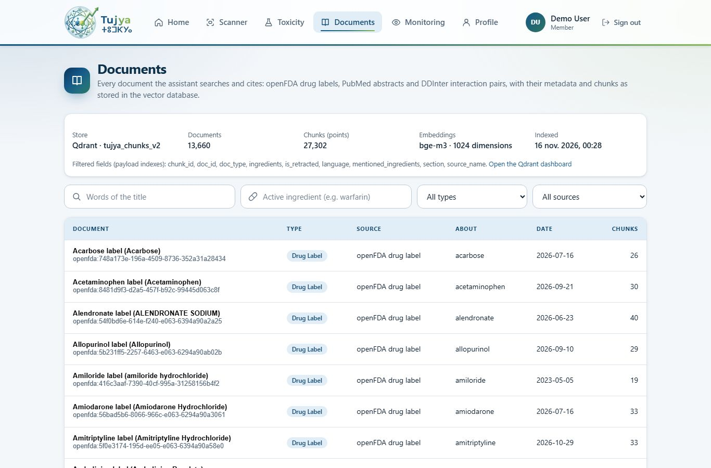
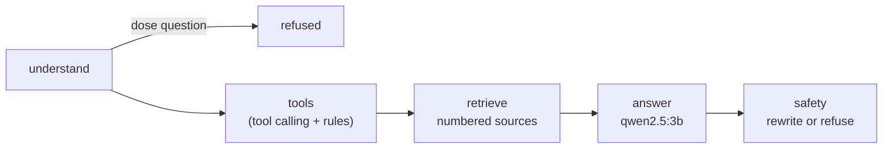
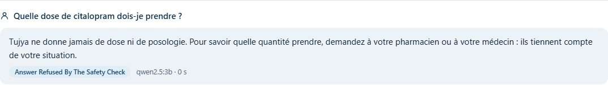
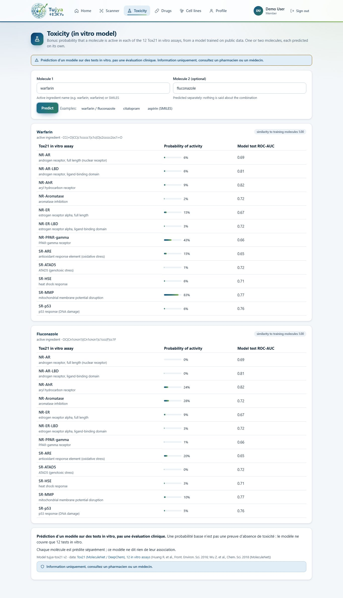

# Module 2: AI engineering

A LangGraph agent answers questions about the scanned pills from a cited RAG corpus (openFDA
labels, PubMed abstracts, DDInter interactions), with safety rules enforced in code. The steps
follow the order of the labs. Results: [results.md](results.md). Commands run from the
repository root in the project venv (`.venv`) with the stack running
(`docker compose up -d`). Executed notebooks of each step:
[notebooks/](../../notebooks/README.md).

## 1. Corpus

| | |
|---|---|
| Code | [src/rag/corpus.py](../../src/rag/corpus.py), [src/data/sources/](../../src/data/sources/), [src/data/spark/rag_sources.py](../../src/data/spark/rag_sources.py), [src/data/spark/rag_job.py](../../src/data/spark/rag_job.py) |
| Command | `python -m src.rag.corpus ingredients`, `interactions`, `labels`, `pubmed`; `python -m src.data.spark.rag_sources labels` and `pubmed` (new ingredients); `dvc repro spark_rag` |
| Result | `data/processed/rag/corpus_v2`: 13,660 documents of 175 ingredients ([data.md](../data.md#rag-corpus)) |

Sources are collected by the polite pipeline (official APIs, rate limits, cache, manifest);
dosage sections are never stored. The Spark job cleans and deduplicates the texts (exact and
MinHash).

## 2. Chunking

| | |
|---|---|
| Code | [src/rag/chunking.py](../../src/rag/chunking.py), variants in [src/evaluation/chunking_variants.py](../../src/evaluation/chunking_variants.py) |
| Command | part of `dvc repro spark_rag` (same functions inside Spark) |
| Result | 27,302 chunks of at most 1,500 characters, one sentence of overlap, each with its metadata (source, type, section, ingredients, language, URL, licence) |

Labels: one chunk per section, long sections split on sentences; abstracts: one chunk per
paragraph; DDInter: one chunk per pair.

## 3. Vector index in Qdrant

| | |
|---|---|
| Code | [src/rag/init_qdrant.py](../../src/rag/init_qdrant.py), [src/rag/stores/qdrant.py](../../src/rag/stores/qdrant.py), [src/rag/stores/sparse.py](../../src/rag/stores/sparse.py) |
| Command | `python -m src.rag.init_qdrant` (run by the `rag-init` container at start-up) |
| Result | http://localhost:6333/dashboard, collection `tujya_chunks_v2`; the Documents page of the app |

One point per chunk: a dense bge-m3 vector (served by Ollama), a BM25 sparse vector and the
metadata as payload. Indexing is idempotent: a chunk is embedded again only if its content hash
changes.

## 4. Retrieval: dense, BM25 and hybrid

| | |
|---|---|
| Code | [src/rag/retrieval.py](../../src/rag/retrieval.py) |
| Command | `python -m src.rag.retrieval "fluconazole warfarin" --ingredient warfarin --k 5` |
| Result | first retrieval table of [results.md](results.md) |

Hybrid search fuses the dense and BM25 lists by reciprocal rank fusion inside Qdrant. Tied RRF
scores are broken deterministically (score descending, then `chunk_id`, as the in-memory fusion
of the SQL store), so the same question always gets the same ranking. The ingredients found in
the question are a metadata filter.

## 5. Query rewriting

| | |
|---|---|
| Code | [src/rag/query_rewriting.py](../../src/rag/query_rewriting.py) |
| Setting | `TUJYA_RAG_QUERY_REWRITE=true` (default) |

The LLM rewrites the question into a short English query that keeps every drug name; an empty,
too long or failed rewrite keeps the question.

## 6. Reranking

| | |
|---|---|
| Code | [src/rag/reranking.py](../../src/rag/reranking.py) |
| Setting | `TUJYA_RAG_RERANK=true`, `TUJYA_RAG_RERANK_MODEL`, `TUJYA_RAG_FETCH_K` |

A cross-encoder (ONNX through fastembed) rescores the first candidates. Measured, but off by
default: it costs seconds per question on the CPU ([results.md](results.md#retrieval-configuration-grid)).

## 7. RAG chain

| | |
|---|---|
| Code | [src/rag/rag_chain.py](../../src/rag/rag_chain.py), prompts in [src/agent/prompts.py](../../src/agent/prompts.py) |

Search -> numbered sources -> prompt -> answer citing `[1]`, `[2]`... The prompts are versioned
and registered in the MLflow Prompt Registry (`python -m src.evaluation.register_prompts`).

## 8. Agent, tools and MCP

| | |
|---|---|
| Code | [src/agent/graph.py](../../src/agent/graph.py), [src/agent/tools.py](../../src/agent/tools.py), [src/agent/safety.py](../../src/agent/safety.py), [src/agent/mcp_server.py](../../src/agent/mcp_server.py), [backend/app/routers/chat.py](../../backend/app/routers/chat.py) |
| Command | `python -m src.agent.ask "Does warfarin interact with fluconazole?"`; `python -m src.agent.mcp_server` (stdio) or `--transport streamable-http --port 8765`; `python -m src.agent.mcp_smoke` |
| Result | the chat panel of the app (`POST /api/chat`, streamed); MLflow traces |

Tools: `identify_pills` (the served vision models), `check_interaction` (DDInter tables),
`get_drug_info`, `search_documents`, `lookup_brand` (brand table, RxNav fallback) and
`predict_toxicity` (bonus). The MCP server exposes the same six tools with the same code. The
safety node removes dose and "safe" sentences and uncited timing advice, checks every citation
and always ends with the disclaimer.

## 9. Evaluation

| | |
|---|---|
| Code | [src/evaluation/](../../src/evaluation/): `build_qrels.py`, `benchmark_retrieval.py`, `retrieval_grid.py`, `encode_sentence_transformers.py`, `benchmark_generation.py`, `ragas_evaluation.py`, `benchmark_brands.py`, `judge_control.py` |
| Command | `python -m src.evaluation.retrieval_grid run --group bge-m3`, `... select`; `python -m src.evaluation.benchmark_generation --llm qwen2.5:3b --prompt v1 --trace`; `python -m src.evaluation.ragas_evaluation --llm qwen2.5:3b --prompt v1`, `... --select --register` |
| Result | [results.md](results.md); MLflow experiments `tujya-rag-retrieval` and `tujya-rag-generation`; registered models `tujya-rag-retrieval` and `tujya-rag-generation` |

Retrieval: Recall@k, MRR and nDCG on 85 questions with expected chunks. Generation: RAGAS
(faithfulness, answer relevancy, context precision and recall), a citation judge and the MLflow
GenAI judges, with safety gates. The embedding fine-tuning (Kaggle) is evaluated on the same
grid.

## Bonus: toxicity tool (Tox21)

| | |
|---|---|
| Code | [src/models/toxicity/](../../src/models/toxicity/), [backend/app/routers/toxicity.py](../../backend/app/routers/toxicity.py) |
| Command | `python -m src.models.toxicity.train_tox21 download`, `train`, `publish` |
| Result | `POST /api/toxicity`, the Toxicity page, the `predict_toxicity` tool; MLflow experiment `tujya-tox` |

One LightGBM model per Tox21 in vitro assay on RDKit Morgan fingerprints, scaffold split.
Each molecule is predicted on its own, never a mixture, and the answer always says it is a
model prediction on in vitro tests, not a clinical judgement; "non-toxic" claims are removed
by the safety node.

