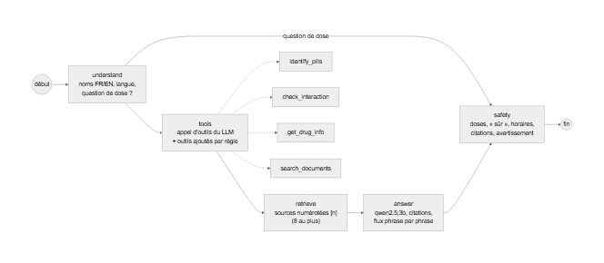

# Agent de Tujya (LangGraph) et POST /api/chat

L'agent répond aux questions sur les comprimés confirmés et leurs principes actifs, à partir
des seuls documents retrouvés et résultats d'outils, avec des citations numérotées. Code :
[`src/agent/`](../../src/agent/) ([graph.py](../../src/agent/graph.py), [tools.py](../../src/agent/tools.py),
[safety.py](../../src/agent/safety.py), [runtime.py](../../src/agent/runtime.py)) et
[`src/rag/names.py`](../../src/rag/names.py) ; route
[`backend/app/routers/chat.py`](../../backend/app/routers/chat.py). Corpus et
recherche : [docs/module2/rag.md](rag.md). Décisions D57 à D59 et D63 ([docs/decisions.md](../decisions.md)).

## Graphe

```
START -> understand --(question de dose)-----------------------> safety -> END
             \--> tools -> retrieve -> answer -> safety -> END
```



| Nœud | Rôle | LLM |
|---|---|---|
| `understand` | noms de médicaments dans la question (français ou anglais : « warfarine » -> warfarin, « paracétamol » -> acetaminophen) et principes actifs des comprimés confirmés ; langue (fr / en) ; question de dose ? | non |
| `tools` | le LLM choisit les appels d'outils (appel d'outils d'Ollama avec les trois outils du chat) ; le graphe ajoute les appels qu'une question exige toujours si le modèle les a oubliés (`check_interaction` dès deux médicaments, `search_documents` toujours), exécute chaque appel et l'enregistre (`chosen_by` : `llm` ou `rule`) | oui (planificateur) |
| `retrieve` | sources numérotées [1], [2]... : d'abord les résultats DDInter de `check_interaction`, puis les extraits de notice de `get_drug_info`, puis les résultats de `search_documents` (dense avec filtre par principe actif par défaut, D65 ; articles rétractés exclus) ; 8 au plus | non |
| `answer` | le LLM répond à partir des seules sources numérotées, avec les règles dans le prompt système (français ou anglais) ; réponse diffusée phrase par phrase à travers le filtre de sécurité | oui |
| `safety` | les règles ci-dessous sur toute la réponse : réécrire, ou refuser | non |

Si l'appel au planificateur échoue (modèle indisponible, JSON invalide), les appels ajoutés
par règle s'exécutent quand même.

## Outils ([`src/agent/tools.py`](../../src/agent/tools.py), partagés avec le serveur MCP)

| Outil | Arguments | Renvoie |
|---|---|---|
| `identify_pills` | `image_path` ou `image_base64` | le résultat de `/api/scan` : boîtes, top-5, `needs_confirmation` (pas proposé au LLM du chat, une question n'a pas d'image ; les clients MCP l'ont) |
| `check_interaction` | `drugs` (noms, français ou anglais), `pills` (class_id) | le résultat de `/api/interactions` : chaque paire, sévérité DDInter, description, source ; « aucune interaction connue dans cette base de données » quand rien n'est listé |
| `get_drug_info` | `drug`, `sections` en option | classes de comprimés contenant le principe actif et le premier chunk de chaque section de la notice (encadré, indications, contre-indications, mises en garde, interactions, mécanisme) |
| `search_documents` | `query`, `ingredients`, `doc_types`, `sections`, `k`, `exclude_retracted` | résultats de recherche avec titre, section, URL, source, date, licence, texte |
| `predict_toxicity` (bonus) | `molecules` (1 ou 2 noms ou SMILES) | probabilités des tests in vitro de Tox21 par molécule, jamais sur un mélange ([docs/bonus/toxicity.md](../bonus/toxicity.md)) ; ajouté par règle à une question de toxicité ; ses phrases dans la réponse sont écrites par le code, pas par le LLM (D74) |

**Point d'extension.** Un outil est une méthode asynchrone de `Toolbox` et une entrée de
`TOOL_SPECS` ; il est alors disponible pour l'agent (`CHAT_TOOLS`) et le serveur MCP. Deux
outils bonus étaient prévus : `predict_toxicity` est implémenté (session 4) ;
`predict_synergy(drug_a, drug_b)` ne l'est pas, l'étude n'ayant pas atteint la règle fixée
d'avance (D75 ; étude retirée du dépôt ensuite, D85).

## Règles de sécurité ([`src/agent/safety.py`](../../src/agent/safety.py), D63)

Appliquées à chaque réponse, phrase par phrase :

1. **Pas de dose.** Une question qui demande une dose (« quelle dose », « posologie »,
   « how much ») est refusée avant tout appel au LLM. Une phrase avec une quantité de
   médicament (« 50 mg », « 2 comprimés », « deux fois par jour », « mg/kg ») est retirée ;
   les valeurs biologiques (« eGFR 30 mL/min », « 200 mg/dL ») ne sont pas des doses.
2. **Jamais « sûr ».** Une phrase avec « sûr », « sans danger », « sans risque », « safe »
   est retirée ; si aucune interaction n'a été trouvée, la réponse écrit à la place
   « Aucune interaction connue dans cette base de données. »
3. **Pas de conseil d'horaire inventé.** Une phrase sur l'espacement des prises ou les
   repas (« 2 heures d'intervalle », « avant le repas », « hours apart ») n'est gardée que si
   elle cite une source.
4. **Citations.** `[n]` doit renvoyer à une source numérotée (les autres sont retirés). Une
   phrase que le modèle a oublié de citer reçoit la source qui contient au moins 60 % de ses
   mots pleins (elle y est donc vraiment) ; une réponse qui ne cite toujours rien reçoit
   « Sources consultées : [1] ... ». Aucune source du tout : la réponse le dit et ne répond
   pas. Les renvois internes des notices (« [see Contraindications (4)] ») sont retirés des
   sources données au modèle et de la réponse.
5. **Avertissement.** Chaque réponse se termine par « Information uniquement, consultez un
   pharmacien ou un médecin. »

Pendant la diffusion, une phrase qui enfreint les règles 1 à 3 est retenue et n'atteint donc
jamais l'écran ; l'événement `final` porte la réponse vérifiée, que le site affiche.

## POST /api/chat

Réservé aux utilisateurs connectés. Corps :

```json
{"question": "La warfarine interagit-elle avec le fluconazole ?", "pills": [9], "stream": false}
```

Réponse (`ChatResult`) : `answer` (vérifiée, terminée par l'avertissement), `language`,
`ingredients`, `citations` (n, title, url, section, snippet, source_name, doc_type, date,
`cited`), `tool_calls` (name, args, chosen_by, ok, summary), `safety` (action `ok` /
`rewritten` / `refused`, violations, numéros cités), `model`, `timings` (par nœud et au
total), `disclaimer`.

Avec `"stream": true`, la réponse est un flux Server-Sent Events : `tool` (chaque appel, au
moment où il a lieu), `token` (texte de la réponse, une phrase vérifiée à la fois), puis
`final` (le `ChatResult`) ou `error`. nginx transmet le flux sans tampon
(`X-Accel-Buffering: no`).

Erreurs : 401 si non connecté ; 503 si l'index est vide (« run
`python -m src.rag.index` ») ou si Ollama est injoignable.

Configuration (`TUJYA_*`) : `OLLAMA_URL` (compose : `http://ollama:11434`), `LLM_MODEL`
(`qwen2.5:3b`), `LLM_TEMPERATURE` (0.1), `LLM_NUM_CTX` (4096, D68), `LLM_MAX_TOKENS` (450),
`EMBEDDING_MODEL` (`bge-m3`), `RAG_TOP_K` (6).

En ligne de commande (venv du projet `.venv`) :
`python -m src.agent.ask "question" [--pills 9 120]`.

## Exemple (vrais modèles, 2026-10-28)

`What are the contraindications of metformin?` -> planificateur : `get_drug_info` et
`search_documents` ; réponse : « Metformin hydrochloride tablets are contraindicated in
patients with severe renal impairment (eGFR below 30 mL/min/1.73 m²), hypersensitivity to
metformin, and acute or chronic metabolic acidosis, including diabetic ketoacidosis with or
without coma [1]. » + avertissement ; environ 15 s au total sur la RTX 2050 (planificateur
~7 s, réponse ~6 s).

## Tests (sans Ollama ni vrais embeddings)

[`tests/agent/test_chat.py`](../../tests/agent/test_chat.py) : un modèle de chat scénarisé
([`backend/tujya_testing/rag_fakes.py`](../../backend/tujya_testing/rag_fakes.py), appels d'outils et réponses diffusées) et
des embeddings factices par hachage sur un corpus de six chunks. Couvre : connexion
obligatoire, choix des outils et appels ajoutés par règle, outils inconnus ignorés,
correspondance des citations, articles rétractés exclus, réponses dangereuses réécrites
(dose, « sans danger », mauvaise citation), question de dose refusée sans appel au LLM,
repli si le planificateur échoue, comprimés -> principes actifs, ordre du flux SSE (tool,
token, final) avec les phrases dangereuses retenues, 503 sans index.
[`tests/agent/test_safety.py`](../../tests/agent/test_safety.py) : les règles et le rapprochement des noms.
